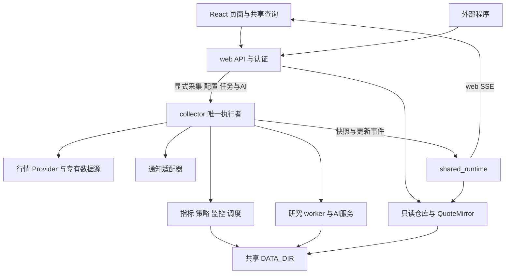

# 当前架构与数据流

Tick Stock Panel 由 React 前端、FastAPI 后端和本地文件数据层组成。后端分为网页服务与唯一采集服务，采集服务持有调度、实时监控与任务执行，并把部分研究计算交给独立进程。本文按 2026-10-10 的源码描述实际关系；目录定位见 [仓库地图](REPO_MAP.md)，数据契约和修改要求见 [CONTRIBUTING.md](../CONTRIBUTING.md)。

## 系统关系

图表示主要控制和依赖关系，不是所有 Python import 的严格分层：当前 `api/` 也会直接组合领域对象，`strategy/paper.py` 等领域模块存在自己的文件读写。`tickflow/repository.py` 名字带有供应商标识，但其中仓库承担多个数据源共享的存储和读取职责。

## 启停与运行边界

[main.py](../backend/app/main.py) 的 `create_app` 根据 `SERVICE_ROLE` 创建角色，默认 `web`；[collector.py](../backend/app/collector.py) 显式创建 collector。collector 的 `lifespan` 取得共享目录独占锁，再初始化数据仓库、挖掘恢复、指标预热、数据源、行情、盘口、普通分时、可选全量分钟、调度、策略及监控引擎。任务恢复和关闭清理仅由 collector 执行。

web 的 `_web_lifespan` 创建只读 `DataStore`、`KlineRepository` 和 [QuoteMirror](../backend/app/services/shared_runtime.py)，加载后台计算后的行情快照，并与 collector 建立一条事件连接。web 不启动供应商轮询、监控执行、调度或任务恢复；缺少快照时返回已有空态。两个进程各有内存仓库和缓存，通过共享 `DATA_DIR` 和更新事件同步。

[collector_proxy.py](../backend/app/services/collector_proxy.py) 明确区分本地读与执行者路径。日线／分钟批量 POST 仍留在 web；配置、策略、监控、采集、回测和 AI 等操作，以及执行者持有的任务／配置查询转交 collector。代理不自动重试，collector 不可用时执行请求返回 503。collector 只绑定本机或私有容器网络，不作为浏览器公开入口。

财务 `GET /api/financials/status` 只在 web 读取本地表覆盖画像；任务和同步时间由 collector 的 `/api/financials/execution-status` 回答。执行状态不可用时，本地报表、搜索与历史报告仍可浏览。

网页服务重启不会取消 collector 的运行中任务。collector 重启时，已有 `JobStore` 恢复逻辑将被中断任务记为失败；这不等于自动续跑。容器部署为两个独立服务和共享卷，开发模式另有 Vite；各自健康状态由 `/health` 提供，具体启动与备份步骤见 [部署文档](deployment.md)。

## 历史数据与指标

盘后管道由数据页通过 [api/pipeline.py](../backend/app/api/pipeline.py) 手动发起，不再注册盘后全量、榜单或盘口定版采集定时器。它编排维表、日线和除权同步，再运行指标流水线，并按配置处理指数、ETF、分钟和市场环境；模拟盘结算在管道中固定执行，不受这些可选开关控制。成功的全量同步仍发布复盘并更新榜单，释放执行槽后按已有开关与日期规则触发周度挖掘。collector 内的任务管理负责去重、唯一写入槽、进度与协作式取消；管道执行协调实时行情暂停，完成或失败后的清理路径刷新仓库缓存。单股日线／分钟获取、指数同步与财务同步复用同一 `JobStore`，接口返回 `job_id`，查询与取消仍走 `/api/pipeline/jobs`。

数据源选择来自 [preferences.py](../backend/app/services/preferences.py)。`TickFlowProvider` 定义在 `data_providers/tickflow_provider.py`，但当前日线、除权、分钟和实时主链仍由 `kline_sync.py`、`quote_service.py` 等服务调用 `tickflow/client.py` 的 SDK 客户端；不能把适配类当作这些流程的统一入口。YAML 源和 `plugin.yaml` 插件由 [custom/loader.py](../backend/app/data_providers/custom/loader.py) 发现并供自定义源分支调用。字段、时间和资产类型在取数边界归一化后落入共享存储。能力矩阵由 [CAPABILITY_REGISTRY](../backend/app/data_providers/capabilities.py) 与各源声明构建，前端通过 `usable` 判断当前能力。

历史完整性检查与修复仍由 [data_integrity.py](../backend/app/services/data_integrity.py) 和显式同步／修复任务负责，手动盘后管道使用已有检查流程；查询和实时开关不再通过自动修复门禁触发补数。该历史检查模块的日历获取逻辑与调度使用的持久化本地日历是不同路径，涉及其口径变化时仍须核对 `test_data_integrity.py`。

[DataStore](../backend/app/tickflow/repository.py) 创建目录并维护 DuckDB `:memory:` 视图，行情主要按日期分区存成 Parquet。股票、ETF 和指数使用各自目录，分钟线也按资产区分。DuckDB 是本地文件的查询层，当前没有独立数据库服务。

enriched 在磁盘上保存基础行情窄表，字段以 [ENRICHED_STORAGE_COLS](../backend/app/indicators/pipeline.py) 和 [存储 schema](../backend/app/parquet.py) 为准。完整指标由 `KlineRepository` 读取历史窗口并通过 `compute_enriched_history_window` 等函数重建；最新日、历史窗口和实时递推状态在内存中复用。因此，磁盘字段清单和 API 可返回的完整指标列并不相同。

[enriched_generation.py](../backend/app/enriched_generation.py) 协调 enriched 发布、读写版本和矩阵缓存所依赖的数据 generation。修改写入路径时，应沿现有发布机制检查视图、仓库快照和研究缓存，不能把写完一个文件等同于所有读者已刷新。

## 实时行情与两类事件流

collector 的 [QuoteService](../backend/app/services/quote_service.py) 默认每 30 秒按路由与交易时段拉取标准行情，在允许写入的阶段更新当日日线和 enriched；`compute_enriched_today` 优先使用历史聚合状态递推。完成缓存更新后，服务评估统一监控规则、更新策略实时结果并驱动模拟盘撮合。取数锁和监控评估锁分开管理。

[OrdinaryMinuteService](../backend/app/services/ordinary_minute.py) 每 30 秒按共享配置中的自选、启用监控标的与核心四指数构建采集池，分别写入股票、ETF、指数分钟分区；页面浏览不改变采集池。可选全市场 [MinuteRefreshService](../backend/app/services/minute_refresh.py) 与普通分时共用采集锁，生效时普通分时跳过其股票部分，避免重复采集。[DepthService](../backend/app/services/depth_service.py) 独立管理五档盘口和封单数据。核心展示指数定义集中在 [index_const.py](../backend/app/services/index_const.py)。

日线、普通／批量分钟及指数行情 GET 只读取本机数据；分钟接口继续接受 `live` 参数，但不再直接访问供应商。显式“获取分钟”集中在数据页，使用后台任务，前端复用现有任务查询与取消机制、`useCollectorJob` 显示进度和错误。业务分时图展示实际本地覆盖并允许重新读取，不发起采集。

[trading_day.py](../backend/app/services/trading_day.py) 的 `sync_calendar` 由 collector 启动与定时器调用，将 fuyao 日历保存到 `calendar/trading_days.json`。`is_trading_day` 只读文件，未覆盖日期返回未知；调度和轮询要求日历明确为交易日，不再请求行情时间戳或猜测工作日。常规连续竞价为北京时间 09:30–11:30、13:00–15:00，午休／休市暂停；实时行情保留 15:00–15:30 的收盘快照确认，确认成功即停止，15:30 起不自动取数。启动时读取持久化自动采集开关，关闭服务不清除该偏好，非交易时段启动也可等待下一交易时段自动恢复。盘前股票基础资料仍在 09:10 自动同步，collector 晚启动时在日历维护后检查并补跑当天未完成的更新；以非空维表的北京日期 `as_of` 去重，休市、日期未知或未到配置时点时跳过；盘口启动只恢复本地快照，盘后定版由数据页手动更新。日历与能力诊断仍属于基础维护，不等同于同步业务数据。

收盘确认逐标的同时比较收盘边界与当天原始分区已存 `quote_ts`，股票、ETF 和指数只合并已确认且不早于本地快照的记录；未确认标的保留原分区和缓存。批量分钟在每次分区写入完成后记录实际写入，任务随后取消或失败仍刷新并发布已保存结果。

[dragon_tiger.py](../backend/app/services/dragon_tiger.py) 和 [auction_benchmark.py](../backend/app/services/auction_benchmark.py) 的取数由 collector 后台执行，当日及历史结果保存到本机；对应 GET 与 AI 上下文只读保存结果。专有榜单仍使用 fuyao 方法，不混入标准能力路由，未配置或无本地结果时返回原空态。

普通分钟的 `ordinary_minute_enabled` 为独立持久化开关，默认开启以保持既有行为；关闭后常驻线程等待，不开始下一轮或下一资产的自动请求，已开始的请求完成落盘。它不跟随实时行情总开关，不阻止显式分钟任务。采集执行函数与触发方式分开，多数已有独立任务入口；维表和榜单也有独立执行函数，但当前没有各自的启停偏好，ETF 主要按全量同步范围执行。全量流程仍保留日K／除权之后重算指标的必要依赖。未来恢复定时可以调用这些既有执行与任务入口；旧财务自动循环并不使用当前统一任务槽，不能仅打开其旧开关就等同于完成定时集成。

[shared_runtime.py](../backend/app/services/shared_runtime.py) 的 `publish_quotes` 原子保存 `runtime/quotes.zip`，包含后台已计算的行情表、指数、状态与必要盘口信息；`publish_data_update` 保存更新标记并发出 `data_updated`。web 的 `bridge_events` 先安装快照或刷新本地视图／缓存，再广播给页面。重连的 `hello` 会补读共享结果并发送全数据集失效，浏览器不必因网页重启重新发起采集。

缓存重建和扩展数据维护先刷新 collector 仓库，再发布共享结果；仓库的生命周期回调在发布前预热 ETF／指数本地指标。扩展表和分钟更新同时清除维度分时缓存；环境与主线重算分别通知对应数据集，前端按查询键失效已有页面结果。

[review_publication.py](../backend/app/services/review_publication.py) 在盘后管道成功后保存 `market_recap/date=YYYY-MM-DD.json`。`GET /api/market-recap/publication?date=...` 默认北京时间当日，返回 `as_of`、`published`、`published_at`、`overview`；未发布时 overview 为 null，复盘页显示“当日复盘尚未更新”。市场快照发布与 AI 成功独立，历史 AI 报告与手动生成入口保留。页面跨北京时间午夜切换当日查询键，查看历史报告时摘要查询跟随报告日期。复盘、财务、个股 AI 流经 [analysis_archive.py](../backend/app/services/analysis_archive.py) 在 collector 归档，完成事件含 `archived: true` 与 `report_id`，前端刷新历史而不重复保存。

| 事件通道 | 后端归属 | 消费与恢复方式 |
| --- | --- | --- |
| 面板 `/api/intraday/stream` | `api/intraday.py` 与 `QuoteService` 订阅机制 | collector 经内部事件连接传入 web；`Layout` 的 `useQuoteStream` 处理行情、告警及 `data_updated`，按数据集失效查询，焦点日 K 可增量合并；重连补读数据与任务状态 |
| 开放 `/api/events` | `api/events.py`、`services/event_tickets.py`、`services/events.py::bus` | Bearer Token 换一次性短期票据，再订阅按 scope 过滤的事件流；重连需新票据，持久结果通过 REST 补取 |

两类通道使用不同的订阅底座。开放总线使用有界队列，慢消费者可能丢旧事件，不是持久事件回放系统。

## 策略与研究执行

[StrategyEngine](../backend/app/strategy/engine.py) 从内置及用户策略目录加载模块，统一基础过滤、策略过滤、评分和排序。它接收同文件定义的 `StrategyDataContext` 等数据上下文，支持表达式、矩阵、叠加与分钟策略模式。[market_data.py](../backend/app/strategy/market_data.py) 另提供策略可访问的指数和 ETF 日 K 只读函数。选股服务负责准备数据与历史窗口，参数持久化在 `strategy/config.py`，结果缓存由 `services/strategy_cache.py` 管理。

策略回测、优化和步进验证主要通过 [backtest/worker.py](../backend/app/backtest/worker.py) 的 `make_worker_task` / `run_worker_task` 进入 `spawn` 子进程。子进程重建数据仓库与策略引擎，读取本地数据，运行研究服务和撮合引擎，将进度与结果传回父进程。信号生成和成交模拟在各自阶段执行；成交时序、T+1、原始价与复权价的约束见贡献规范和 `tests/backtest/`。

另有 [services/backtest.py](../backend/app/services/backtest.py) 的信号回测路径使用可选 `vectorbt`，不能把它与矩阵策略回测的依赖和执行方式混为一谈。挖掘由 [MiningJobManager](../backend/app/services/mining_manager.py) 与 `MiningRunStore` 管理持久任务状态、事件和研究产物，重启恢复由生命周期调用；候选保存与发布是独立操作，详见 [mining.md](mining.md)。

## 重要状态归属

下列路径相对于实际 `DATA_DIR`；开发默认目录为项目根 `data/`。

| 状态或数据 | 持久化及内存所有者 |
| --- | --- |
| 日线、分钟、除权、维表、财务 | 对应 Parquet 目录；`DataStore` 视图及 `KlineRepository` 的最新日、历史窗口和实时聚合缓存 |
| 专有榜单与调度日历 | `dragon_tiger/date=YYYY-MM-DD.json`、`auction_benchmark/date=YYYY-MM-DD.json` 保存当日及历史榜单；`calendar/trading_days.json` 保存调度日历，collector 更新、各查询只读 |
| 跨服务行情与复盘 | `runtime/quotes.zip` 保存行情快照；`runtime/data_update.json` 保存更新标记；`market_recap/date=YYYY-MM-DD.json` 保存已发布复盘 |
| 采集任务 | `job_store/<id>.json` 保存创建／运行／终态，运行中进度由 collector 内存持有，web 查询与取消转发到 collector |
| 策略源码、参数与结果 | `strategies/custom`、`ai`、`composite`；`strategy/config.py` 管参数；`user_data/strategy_cache.json` 管结果，监控引擎还保存盘中结果 |
| 自选、规则、告警与偏好 | 对应服务管理用户文件；告警在 `user_data/alerts.jsonl`，运行中规则与冷却状态由监控引擎管理 |
| 自定义因子 | `user_data/custom_factors/`；`factors/store.py` 持久化，`factors/registry.py` 管运行时注册 |
| 扩展数据 | `ext_data/<config_id>/` 下配置与 Parquet；`ExtConfigStore`、扩展因子和仓库各有派生缓存 |
| 挖掘任务 | `research/mining/runs/`；`MiningRunStore` 管状态与产物，`MiningJobManager` 管执行和取消 |
| 回测矩阵缓存 | `.backtest_matrix_cache/`；`backtest/matrix.py` 与 `strategy.py` 管构建和复用，数据 generation 由 enriched 发布机制维护 |
| 模拟盘 | `paper/accounts/<account_id>/`；`fills.jsonl` 是成交事实源，持仓等由台账重放推导 |
| 登录与开放授权 | `services/auth.py`、`api_tokens.py` 管持久凭据；开放限流、票据与事件队列在进程内 |
| 浏览器查询与界面状态 | `main.tsx` 的 TanStack Query；`queryPersist.ts` 只持久化白名单慢变查询，长任务另由 `backtestTask.ts` 等 store 管理 |

这些缓存没有一个统一失效开关。一个写操作可能需要同步仓库、enriched generation、策略结果、扩展因子和前端查询；具体范围应沿真实调用链确认。

财务全市场同步在 `financial_sync._get_symbols` 核对请求股票池。实现可选 `get_financial_universe` 的 provider 提供当前 canonical 代码范围；Fuyao 使用全市场快照清单，因此不会请求其清单外的历史代码，也会纳入基础维表尚未收录的代码。服务将核对时间、源名称、数量与双向差异保存到 `financials/universe.json`，不修改基础维表或删除历史报表。未实现该方法的源沿用本地维表；清单异常或为空时停止同步，后续报表请求仍保留原有失败、限流和取消语义。清单存在不代表每股每期都有报表，实际覆盖以落库结果为准。

## 前端与扩展边界

核心前端请求和类型集中在 [lib/api.ts](../frontend/src/lib/api.ts)，查询键与共享查询主要在 `queryKeys.ts`、`useSharedQueries.ts`。页面路由按需加载，`Layout` 负责跨页面状态与行情订阅。慢变查询可由 localStorage 恢复，但挂载后仍按查询策略刷新；快变行情不在持久化白名单。

首页由 [router.tsx](../frontend/src/router.tsx) 直接挂载 `Layout` 和 `Dashboard`，保留既有认证流程。首次配置向导、完成标记与专用完成接口已移除；进入页面只读取后端现有配置，不自动选择或保存能力路由。Key 由 [secrets_store.py](../backend/app/secrets_store.py) 读取本地凭据及环境后备值，路由由 [preferences.py](../backend/app/services/preferences.py) 读取，未设置时使用既有默认值。TickFlow / AI 密钥只由后端配置，settings API 仅暴露配置状态（旧脱敏字段为空），拒绝网页替换或清除密钥。能力路由和 AI 非密钥选项仍通过设置页及 settings API 修改。

采集、共享数据重算和缓存维护集中在 [Data.tsx](../frontend/src/pages/Data.tsx)：财务五表、指数日 K、单标的分钟、概念／行业预设、历史环境与主线、实时采集开关与手动获取、五档盘口更新、共享缓存重建均复用现有接口。管道任务通过 `active_id` 恢复；分钟与财务维护复用 `useCollectorJob`，财务以 `active_job_id` 恢复。盘后同步由维护者手动发起，盘前基础资料与交易日历维护仍由 collector 调度器执行。数据页和设置页的 admin 权限尚未实现。

页面常用同步按行情与基础数据、分钟历史、财务、板块分类四个大模块组织，配置与单项补采留在维护选项。前端一次提交一个模块任务，不并行拼接子接口。行情沿用原管道依赖顺序；分钟历史复用全 A 股批量任务，独立于随管道同步开关；财务五表沿用串行执行。显式声明 `on_chunk_done` 的财务插件报告原生进度，旧插件仍按服务已有的 100 股批长逐批调用；Generic HTTP 保留原配置批长与共享 RPM。Fuyao 仅在单表内使用两个有界在途任务并行逐股取数，指标仍先查询利润表、再获取 BPS 快照和对应报告期指标；所有 Fuyao 客户端 API 请求共用采集进程内的两个请求槽及 0.12 秒发包间距，这是项目控频策略，官方仅公开动态限流规则。协调线程通过原任务进度回调检查取消后才补交请求，取消／异常等待已在途请求收尾；429／4001 以 `ProviderRateLimitError` 传播，当前未完成表不写入。整张表仍在获取结束后合并历史并原子写入。新增板块分类动作 `POST /api/ext-data/presets/sync` 复用既有预设转换，概念与行业串行写入，共用 JobStore、写入槽、容量与取消机制；执行退出时对实际写入统一刷新并发布，部分失败或取消也保留已保存结果且任务终态如实报告。原单表接口保持可用。现有扩展 PullScheduler 仍是原独立定时路径，此次没有改变其调度或并发边界。

手动采集先通过 `POST /api/data/sync-check` 查询 collector 本地证据，不请求供应商、不创建任务。`collection_status.py` 比较既有任务结果中保存的路由／范围、任务终态、本地非空结果及已收盘交易日；默认未启用的可选步骤不算失败，缺能力或失败步骤不算完成。旧任务未保存这些参数时不作重复判断，盘中行情和日历未知时不声称最新。财务／扩展表没有供应商版本证据，提示只描述已完成任务或已保存的本地结果；盘口提示明确快照可能来自盘中。前端统一确认框提供取消／重新拉取，检查失败明确显示错误，确认才调用原采集接口。此交互与执行层分开，后端定时任务无需弹窗或确认参数。

模块预检查包含全市场分钟与概念／行业组合：分钟仅在同源、同范围的收盘后任务成功且有本地结果时提示已执行；分类需两表都有今天保存的非空结果，缺一表时直接发起同步。提示不证明上游未修订或全部标的覆盖。全市场分钟任务提交时固定本次实际天数，沿用原 API 与请求标识，并在已有结果中附加范围证据。

业务页的刷新只重新读取本地结果，保留研究计算、AI 分析和业务操作。财务浏览、历史报告、基于本地财务的 AI 分析和本地分钟成交研究不依赖当前供应商采集能力；能力检查留在采集入口。回测与挖掘只提示共享环境数据缺口，不在业务页面补算。概念和行业页面只读取后台保存的预设结果。普通 AI 助手保留查询和业务动作，已移除 `sync_data` 工具。

源码二开通过独立注册表接线。前端当前开放 `layout.navigation.extra`、`stock-preview.footer`、`watchlist.toolbar`，类型以 [FrontendSlotContextMap](../frontend/src/extensions/types.ts) 为准；版本字段在扩展清单 `apiVersion` 上，当前插槽 context 未包含文档示例中的 `apiVersion`。前端在构建路由前完成校验并冻结注册表。后端提供路由、启动钩子和 [NotificationFormatter](../backend/app/extensions/contracts.py)，加载器隔离注册失败；应用构建时完成注册并冻结，核心服务初始化后再运行可选启动钩子，钩子不能追加注册。

AI 助手由 `frontend/src/custom/assistant/` 和 `backend/app/custom/assistant/` 接入，调用现有查询和动作能力，写动作经过确认流程。其后端请求会注入 `app.state` 中的核心服务，前端使用自己的流式客户端和会话 store；`AiConfigEntry.tsx` 还通过 DOM 与 portal 锚定设置入口，升级时需要复核相关布局。不能将这些具体做法推断为所有扩展的稳定公共接口。

候选过滤、仓位、风控、回测成本和配置迁移注册等设计接口不等于已实现 API，使用前应检查定义与调用方。[secondary-development.md](secondary-development.md) 同时包含规范和按需扩展示例，新文档中的现状描述不替代其中的契约要求。

## 外部系统与核对范围

外部依赖包括行情供应商或用户 HTTP 源、AI 服务或 Codex CLI、通知通道。外部程序可通过开放 API 访问面板；stocksdk 插件另有 Node 桥接，OCR 涉及 Tesseract 等机器能力，详情在对应模块与配置文档。

本文基于入口、代表性调用链、存储与类型定义及现有测试源码核对，没有验证真实行情源、模型服务、通知投递或全部平台运行行为。具体性能数值、第三方可用性和业务正确性需要对应任务的实际验证；后续修改入口、职责、数据流或缓存归属时应同步相关段落。
