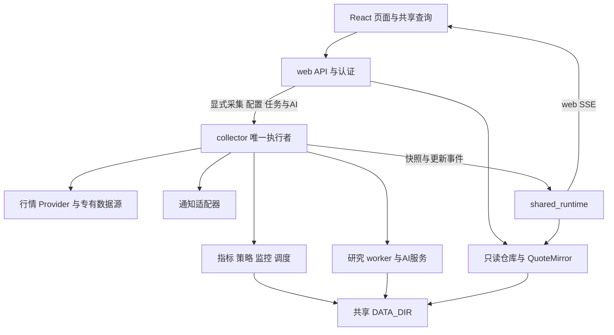

# 当前架构与数据流

小帅工作台仅维护通过浏览器访问的 Linux 服务器版，由 React 前端、FastAPI 后端和服务器文件数据层组成。后端分为网页服务与唯一采集服务，采集服务持有调度、实时监控与任务执行，并把部分研究计算交给独立进程。本文描述源码中的主要关系；目录定位见 [仓库地图](REPO_MAP.md)，数据契约和修改要求见 [CONTRIBUTING.md](../CONTRIBUTING.md)。

## 系统关系

图表示主要控制和依赖关系，不是所有 Python import 的严格分层：当前 `api/` 也会直接组合领域对象，`strategy/paper.py` 等领域模块存在自己的文件读写。`tickflow/repository.py` 名字带有供应商标识，但其中仓库承担多个数据源共享的存储和读取职责。

## 启停与运行边界

[main.py](../backend/app/main.py) 的 `create_app` 根据 `SERVICE_ROLE` 创建角色，默认 `web`；[collector.py](../backend/app/collector.py) 显式创建 collector。collector 的 `lifespan` 取得共享目录独占锁，再初始化数据仓库、挖掘恢复、指标预热、数据源、行情、盘口、普通分时、可选全量分钟、调度、策略及监控引擎。任务恢复和关闭清理仅由 collector 执行。

web 的 `_web_lifespan` 创建只读 `DataStore`、`KlineRepository` 和 [QuoteMirror](../backend/app/services/shared_runtime.py)，加载后台计算后的行情快照，并与 collector 建立一条事件连接。web 不启动供应商轮询、监控执行、调度或任务恢复；缺少快照时返回已有空态。两个进程各有内存仓库和缓存，通过共享 `DATA_DIR` 和更新事件同步。

[collector_proxy.py](../backend/app/services/collector_proxy.py) 明确区分本地读与执行者路径。日线／分钟批量 POST 仍留在 web；配置、策略、监控、采集、回测和 AI 等操作，以及执行者持有的任务／配置查询转交 collector。代理不自动重试，collector 不可用时执行请求返回 503。collector 只绑定本机或私有容器网络，不作为浏览器公开入口。

财务 `GET /api/financials/status` 只在 web 读取本地表覆盖画像；任务和同步时间由 collector 的 `/api/financials/execution-status` 回答。执行状态不可用时，本地报表、搜索与历史报告仍可浏览。

网页服务重启不会取消 collector 的运行中任务。collector 重启时，已有 `JobStore` 恢复逻辑将被中断任务记为失败；这不等于自动续跑。容器部署为两个独立服务和共享卷，开发模式另有 Vite；各自健康状态由 `/health` 提供，具体启动与备份步骤见 [部署文档](deployment.md)。

## 历史数据与指标

盘后管道由 collector 默认在北京时间 16:00 自动发起，也可由数据页通过 [api/pipeline.py](../backend/app/api/pipeline.py) 手动发起。自动入口 [postmarket.py](../backend/app/services/postmarket.py) 只在本地日历确认的交易日运行，未完成时当天每 15 分钟重试；成功任务按持久化记录去重，手动取消后当天暂停。自动管道同步完整维表、正式日线、除权因子、指标和核心指数，通过当日覆盖与数值验收后，顺序提交分类、增量计算环境／情绪／主线，再结算模拟盘、处理可选分钟／盘口／榜单并发布复盘；ETF 与分钟保持原开关，A 股／核心指数／环境是自动任务固定范围。依赖、完成条件和边界见 [盘后同步顺序约定](postmarket-pipeline.md)。释放执行槽后按已有开关与日期规则触发周度挖掘。collector 内的任务管理负责去重、唯一写入槽、进度与协作式取消；管道执行协调实时行情暂停，完成或失败后的清理路径刷新仓库缓存；仅写独立财务表的长任务不暂停实时行情。单股日线／分钟获取、指数同步与候选财务核验复用同一 `JobStore`，接口返回 `job_id`，查询与取消仍走 `/api/pipeline/jobs`。

自动股票池读取本轮维表的 `is_current` 标记。TickFlow 元数据同步在严格模式额外读取 `CN_Equity_A` 完整成员名单，标记退市、合并等历史非当前成员；名单不可用或成员缺少维表信息时，在写维表前失败。历史记录仍保留，普通盘前同步不继承旧成员证据；自定义源可声明 `ext.is_current`，缺省状态继续兼容。停牌股保留在当前股票池，正式日线覆盖仍需当日停牌证据，不按缺行豁免。

自动任务取得正式日线后，`postmarket.reconcile_daily_status` 仅为未解释的缺行调用独立的 [交易状态适配器](../backend/app/data_providers/trading_status.py)，按目标日期核对东方财富停复牌区间与 IPO 日程。确认的全天停牌和尚未上市分别计入 `DailyCoverage.halted/not_listed`；当日上市／复牌、盘中临停、未知日期及实际取数失败仍须正式日线。状态分页、日期或网络异常阻止指标与环境计算。适配器每轮重新请求，沿用任务取消检查，不改变行情来源、仓库、generation 或发布缓存；状态结果仅随本次验收摘要保存。

[pipeline_prefetch.py](../backend/app/services/pipeline_prefetch.py) 在自动任务的日线与因子就绪后，以最多两个工作线程预取近端核心指数、概念／行业分类、竞价风向标和龙虎榜，与股票指标计算重叠。指数窗口最多 14 个自然日，深历史沿用原分批路径；预取线程不访问仓库写入、DuckDB 或指标计算，主线程按原验收依赖等待并提交。取消时停止未开始的预取，等待在途请求退出再释放任务槽。环境前的缓存刷新和任务边界最终刷新保留，自动成功路径不在复盘发布前重复全量加载股票指标。供应商限频继续生效，TickFlow 首批也等待进程内预约槽；预算不跨进程共享。

数据源选择来自 [preferences.py](../backend/app/services/preferences.py)。`TickFlowProvider` 定义在 `data_providers/tickflow_provider.py`，但当前日线、除权、分钟和实时主链仍由 `kline_sync.py`、`quote_service.py` 等服务调用 `tickflow/client.py` 的 SDK 客户端；不能把适配类当作这些流程的统一入口。YAML 源和 `plugin.yaml` 插件由 [custom/loader.py](../backend/app/data_providers/custom/loader.py) 发现并供自定义源分支调用。字段、时间和资产类型在取数边界归一化后落入共享存储。能力矩阵由 [CAPABILITY_REGISTRY](../backend/app/data_providers/capabilities.py) 与各源声明构建，前端通过 `usable` 判断当前能力。

历史完整性检查与修复仍由 [data_integrity.py](../backend/app/services/data_integrity.py) 和显式同步／修复任务负责，手动盘后管道使用已有检查流程；查询和实时开关不再通过自动修复门禁触发补数。该历史检查模块的日历获取逻辑与调度使用的持久化本地日历是不同路径，涉及其口径变化时仍须核对 `test_data_integrity.py`。

[DataStore](../backend/app/tickflow/repository.py) 创建目录并维护 DuckDB `:memory:` 视图，行情主要按日期分区存成 Parquet。股票、ETF 和指数使用各自目录，分钟线也按资产区分。DuckDB 是本地文件的查询层，当前没有独立数据库服务。

enriched 在磁盘上保存基础行情窄表，字段以 [ENRICHED_STORAGE_COLS](../backend/app/indicators/pipeline.py) 和 [存储 schema](../backend/app/parquet.py) 为准。完整指标由 `KlineRepository` 读取历史窗口并通过 `compute_enriched_history_window` 等函数重建；最新日、历史窗口和实时递推状态在内存中复用。因此，磁盘字段清单和 API 可返回的完整指标列并不相同。

[enriched_generation.py](../backend/app/enriched_generation.py) 协调 enriched 发布、读写版本和矩阵缓存所依赖的数据 generation。修改写入路径时，应沿现有发布机制检查视图、仓库快照和研究缓存，不能把写完一个文件等同于所有读者已刷新。

发布持有跨进程文件锁直到提交或异常收尾，不能依据心跳超时抢占仍在计算的写入者。替换分区前先记录写入状态；异常退出释放执行归属，已部分修改的数据继续阻止读取，交由后续完整重建恢复。collector 启动只释放能够确认尚未写入的遗留发布。全量重建的日期覆盖保护只检查原始日线仍存在的日期；日线已不存在的旧指标分区保留并记录告警，不再阻止其余数据重建。

ETF 显式同步遇到未完成发布时，先使用本地 ETF 日线与因子按每批 100 个标的重建，在全部日期写入成功后统一提交。批次间复用原进度／取消回调；失败仍保留未完成状态，下一次同步重新恢复。恢复成功即刷新视图并失效 ETF 指标缓存，不依赖后续网络取数成功；无本地源数据时明确失败，GET 和普通实时写入不启动完整恢复。

量比的全量重算与实时递推共用 [volume_ratio.py](../backend/app/indicators/volume_ratio.py)，使用各行同日北京时间 `quote_ts` 折算累计成交量，午休不累加交易分钟。正式日线无快照时间时按全天成交量计算；实时调用缺少时间时才使用显式传入的已交易分钟数。历史快照重算不依赖执行时钟。日线策略矩阵在内存、Parquet 直读、磁盘缓存和实时更新中保留独立时间因子，使 `vol_ratio_5d` 过滤不依赖是否开启该字段评分；原始成交量及其他研究因子定义保持不变。302 与 300／301 使用相同创业板分类和限价规则，689 纳入科创板；回测矩阵版本失效后重新构建相应限价与锁板标记。

## 板块复盘

独立「板块复盘」页 `/sector-review` 经 `api/sector_review.py` 访问 web 本机的 `services/sector_review.py`，事件共振与调整逆势共享 `sector_review_rules.py`。`KlineRepository.sector_review_reader()` 提供窄列读取边界：正式原始日线校验 OHLC、成交字段和 `quote_ts`，股票收益使用与原始收盘一致的 enriched 前复权 close；不访问实时缓存、不预热指标、不迁移配置、不采集和归档。

成员按事前21个连续交易日收盘及20日成交额形成，之后固定；缺失不补零、不删成员重新归一。当前分类回看历史的限制常显，ETF 未配置单独降级。版本键包含目录、日期／窗口、分类、日历、股票／指数／ETF文件签名、已有发布标记和规则；同键单飞、有界缓存，读取中版本变化丢弃并重试。重叠概念的临时聚合按10个日期分批以限制内存，股票历史仍一次批量读取。成员分页携带摘要版本，修订后返回409。前端随日线、分类、日历及配置发布失效，不随实时报价高频重算；collector日历成功持久化后发布独立 `calendar` 数据更新通知。设计与验证边界见 [设计基线](sector-review-design.md) 和 [实现记录](sector-review-implementation.md)。

## 实时行情与事件流

collector 的 [QuoteService](../backend/app/services/quote_service.py) 默认每 30 秒按路由与交易时段拉取标准行情，在允许写入的阶段更新当日日线和 enriched；`compute_enriched_today` 优先使用历史聚合状态递推。完成缓存更新后，服务评估统一监控规则、更新策略实时结果并驱动模拟盘撮合。取数锁和监控评估锁分开管理。

选股缓存响应通过 [screener_quotes.py](../backend/app/services/screener_quotes.py) 在副本上合入同日行情展示字段；评分、入选信号和历史结果保持原计算口径。冷行情缓存不触发同步指标重算，展示投影不写回个人策略缓存。前端行情事件刷新当前日期明细，继续复用共享行情，不为列表各行单独采集。

[OrdinaryMinuteService](../backend/app/services/ordinary_minute.py) 每 30 秒按共享配置中的自选、启用监控标的与核心四指数构建采集池，分别写入股票、ETF、指数分钟分区；页面浏览不改变采集池。可选全市场 [MinuteRefreshService](../backend/app/services/minute_refresh.py) 与普通分时共用采集锁，生效时普通分时跳过其股票部分，避免重复采集。[DepthService](../backend/app/services/depth_service.py) 独立管理五档盘口和封单数据。核心展示指数定义集中在 [index_const.py](../backend/app/services/index_const.py)。

日线、普通／批量分钟及指数行情 GET 只读取本机数据；分钟接口继续接受 `live` 参数，但不再直接访问供应商。数据页的分钟维护使用后台任务，前端复用现有任务查询与取消机制、`useCollectorJob` 显示进度和错误。单日分时空态另提供所有登录用户可用的“采集该日分钟数据”按钮，显式调用 `POST /api/kline/minute/fetch`，只补所选标的和日期；页面打开与普通刷新仍只读本地。请求复用 collector 的 `JobStore`，相同标的、资产和日期的在途请求共享任务；取得分钟采集锁后再次检查本地数据，已有结果直接复用，避免任务完成后的迟到请求重复取数。其他数据任务占用执行槽时返回忙碌提示。`GET /api/kline/minute/fetch/{job_id}` 仅提供本类任务的进度，不开放管理员任务列表或取消接口。成功后沿分钟分区、仓库刷新、共享发布及前端分钟查询失效链路更新图表，空结果和失败允许重试。

[trading_day.py](../backend/app/services/trading_day.py) 的 `sync_calendar` 由 collector 启动与定时器调用，将 fuyao 日历保存到 `calendar/trading_days.json`。`is_trading_day` 只读文件，未覆盖日期返回未知；调度和轮询要求日历明确为交易日，不再请求行情时间戳或猜测工作日。常规连续竞价为北京时间 09:30–11:30、13:00–15:00，午休／休市暂停；实时行情保留 15:00–15:30 的收盘快照确认，确认成功即停止，15:30 起实时轮询停止，正式盘后同步由独立的 16:00 管道执行。启动时读取持久化自动采集开关，关闭服务不清除该偏好，非交易时段启动也可等待下一交易时段自动恢复。盘前股票基础资料仍在 09:10 自动同步，collector 晚启动时在日历维护后检查并补跑当天未完成的更新；以非空维表的北京日期 `as_of` 去重，休市、日期未知或未到配置时点时跳过；盘口启动只恢复本地快照，盘后管道按能力更新，数据页保留手动补采。日历与能力诊断仍属于基础维护，不等同于同步业务数据。

收盘确认逐标的同时比较收盘边界与当天原始分区已存 `quote_ts`，股票、ETF 和指数只合并已确认且不早于本地快照的记录；未确认标的保留原分区和缓存。批量分钟在每次分区写入完成后记录实际写入，任务随后取消或失败仍刷新并发布已保存结果。

[dragon_tiger.py](../backend/app/services/dragon_tiger.py) 和 [auction_benchmark.py](../backend/app/services/auction_benchmark.py) 的取数由 collector 后台执行，当日及历史结果保存到本机；对应 GET 与 AI 上下文只读保存结果。专有榜单仍使用 fuyao 方法，不混入标准能力路由，未配置或无本地结果时返回原空态。

普通分钟的 `ordinary_minute_enabled` 为独立持久化开关，默认开启；关闭后常驻线程等待，不开始下一轮或下一资产的自动请求，已开始的请求完成落盘。它不跟随实时行情总开关，不阻止显式分钟任务。维表和榜单当前没有各自的启停偏好，ETF 主要按全量同步范围执行。全量流程保留日 K／除权之后重算指标的依赖。

[shared_runtime.py](../backend/app/services/shared_runtime.py) 的 `publish_quotes` 原子保存 `runtime/quotes.zip`，包含后台已计算的行情表、指数、状态与必要盘口信息；`publish_data_update` 保存更新标记并发出 `data_updated`。web 的 `bridge_events` 先安装快照或刷新本地视图／缓存，再广播给页面。重连的 `hello` 会补读共享结果并发送全数据集失效，浏览器不必因网页重启重新发起采集。

缓存重建和扩展数据维护先刷新 collector 仓库，再发布共享结果；仓库的生命周期回调在发布前预热 ETF／指数本地指标。扩展表和分钟更新同时清除维度分时缓存；环境与主线重算分别通知对应数据集，前端按查询键失效已有页面结果。

[review_publication.py](../backend/app/services/review_publication.py) 在盘后管道成功后保存 `market_recap/date=YYYY-MM-DD.json`。`GET /api/market-recap/publication?date=...` 默认北京时间当日，返回 `as_of`、`published`、`published_at`、`overview`；未发布时 overview 为 null，复盘页显示“当日复盘尚未更新”。市场快照发布与 AI 成功独立，历史 AI 报告与手动生成入口保留。页面跨北京时间午夜切换当日查询键，查看历史报告时摘要查询跟随报告日期。复盘、财务、个股 AI 流经 [analysis_archive.py](../backend/app/services/analysis_archive.py) 在 collector 归档，完成事件含 `archived: true` 与 `report_id`，前端刷新历史而不重复保存。

页面事件入口为 `/api/intraday/stream`，由 `api/intraday.py` 与 `QuoteService` 管理订阅。collector 经内部事件连接传入 web，`Layout` 的 `useQuoteStream` 处理行情、告警与 `data_updated`，按数据集失效查询并合并焦点日 K；重连后补读数据与任务状态。

## 策略与研究执行

[StrategyEngine](../backend/app/strategy/engine.py) 从内置及用户策略目录加载模块，统一基础过滤、策略过滤、评分和排序。它接收同文件定义的 `StrategyDataContext` 等数据上下文，支持表达式、矩阵、叠加与分钟策略模式。[market_data.py](../backend/app/strategy/market_data.py) 另提供策略可访问的指数和 ETF 日 K 只读函数。选股服务负责准备数据与历史窗口，参数持久化在 `strategy/config.py`，结果缓存由 `services/strategy_cache.py` 管理。

内置“业绩断层回踩”（`earnings_breakout_pullback`）使用既有历史过滤策略契约，经 `market_data.get_earnings_breakout_signals` 调用共享业绩断层服务。利润表版本与完整前序日线各批量读取一次，随后在内存中逐股复用主图算法；调用方同日行情覆盖存储行，`ScreenerService` 也在历史上下文中用当前快照替换同日旧行。引擎只输出所选交易日出现“缺口”或“中点”的股票，两者同时触发只列一次；默认没有额外基础过滤、评分或数量截断。计算仍为只读，显式运行前由共享按需服务准备候选利润表，结果沿用当次选股快照缓存，财务或行情更新后显式重跑读取新输入。该策略声明 `realtime_supported=false`，前端隐藏监控入口，监控保存接口拒绝、实时评估器跳过，避免在行情热路径扫描完整历史；日线回测候选使用相同历史过滤函数，不新增成交或卖出规则。

显式断层命令通过 `EarningsPriceSnapshot` 在本次 `StrategyDataContext` 中传递完整价格及回踩价格指标，财务候选准备和最终筛选共用；历史过滤调用以 `ContextVar` 作用域绑定并在退出时恢复，不建立跨用户或跨命令长驻缓存。复用校验数据目录、截止日、股票池和最终输入 OHLCV：新增股票补读，日期或目录变化重新读取，历史/实时覆盖变化重新计算受影响股票。利润表版本仍在准备结束后读取，保持新采集数据与公告生效口径。

独立“业绩断层跳空”（`earnings_breakout_gap`）通过 `market_data.get_earnings_gap_signals` 复用同一服务的批量加载与计算，只选所选交易日的 `earnings_gap`，对应主图“断”标记：当时可用的同源正式报表净利润为正且同比增长，并在该报表首次可用日后首个交易日形成最低价高于前一交易K线最高价的完整向上缺口。它不要求回踩或PSY、多空线、阳线等回踩附加条件，不把普通高开或非财报事件日的缺口当作业绩断层。两个策略拥有独立稳定ID、结果与配置，均仅手动日线筛选；缺少当时财务依据不补信号，后续修订不重激活或抹掉既定事件，K线指标继续保留。

跳空策略卡片沿用普通选股的缓存读取与缺失计算入口，重复点击或刷新页面后查看已缓存结果不会启动候选核验。管理员在最新交易日点击独立「核验／重新核验」按钮时，显式提交 `POST /api/screener/earnings-gap/verify`：`services/earnings_gap_review.py` 先只读价格扫描完整向上缺口，再通过 `financial_sync.sync_candidate_income` 仅更新候选股扶摇利润表，最后复用上述财报事件时间与利润条件核验。任务沿用 JobStore、统一财务写入槽、限频、冷却与取消，不暂停行情；执行与每次写入前重新核实会话和管理员身份。部分更新不改全市场股票池、同步断点或上次全市场成功时间。GET 与轮询只读；普通策略、回测和研究任务在 collector 准备依赖后计算，此管理员候选命令仍仅适用于最新交易日。

候选核验快照保存在个人策略结果缓存的 `verification` 中，区分已确认、待核验和利润条件未通过。只有已确认股票进入 `rows`、当日曾命中及策略聚合；前端仅展示确认结果与任务状态，未确认候选及其计数保留在后台，不作为选股结果展示。普通同日重算保留最近显式核验快照，跨日清除。休市期间的可用日期映射到之后首个交易日，日期级数据无法证明具体夜间披露时刻；仍沿用供应商更新日与本地观察日规则，已建基线后在跳空当日才观察到的新版本不能倒填为当天确认，即使本次查询成功也可能持续待核验。后续修订不抹除既定事件。

策略回测、优化和步进验证主要通过 [backtest/worker.py](../backend/app/backtest/worker.py) 的 `make_worker_task` / `run_worker_task` 进入 `spawn` 子进程。子进程重建数据仓库与策略引擎，读取本地数据，运行研究服务和撮合引擎，将进度与结果传回父进程。信号生成和成交模拟在各自阶段执行；成交时序、T+1、原始价与复权价的约束见维护约定和 `tests/backtest/`。

另有 [services/backtest.py](../backend/app/services/backtest.py) 的信号回测路径使用可选 `vectorbt`，不能把它与矩阵策略回测的依赖和执行方式混为一谈。挖掘由 [MiningJobManager](../backend/app/services/mining_manager.py) 与 `MiningRunStore` 管理持久任务状态、事件和研究产物，重启恢复由生命周期调用；候选保存与发布是独立操作，详见 [mining.md](mining.md)。

## 多用户计算与缓存

选股单策略、自定义筛选、分钟及批量运行统一进入 `services/strategy_run_queue.py` 的单工作线程队列，并取得 `heavy_job_limiter` 的独占执行槽（冷缓存可能重建全量 enriched）。相同用户、数据目录、引擎注册表、数据 generation、资产／周期／日期及参数的在途请求复用结果；已完成后的显式重跑仍新建执行，不跨用户复用个人结果。前端卡片优先读取缓存，已有批次等待结果时不重复提交单策略。单策略写回只更新已有同日缓存，日期校验与合并写入共用用户文件锁；历史查询不会替换其他日期的整份结果或曾命中记录。

渐进批量响应携带 `run_id`，前端通过 `GET /api/screener/run-status/{run_id}` 查询待处理、成功、单策略失败与整体终态。该只读接口转交 collector，并校验用户及数据目录归属；终态最多保存 30 分钟、全进程最多 256 份轻量摘要，不保留 Future 或异常调用栈。任务状态与成功结果缓存分开，迟发错误和结果保存失败都能结束对应卡片的等待；重跑获得新 ID，旧任务状态不会覆盖新任务。页面按资产与日期分别保留任务标识和待提交策略队列，切走时隔离显示，返回原上下文后恢复状态查询，并在原批次结束后提交该上下文的新增策略；队列合并去重且提交前移除，反复切换不会重复提交。切换期间收到的首返仍保存在原请求上下文中，默认日期确认时同步迁移待提交队列。

`services/task_scheduler.py` 为选股和研究分别提供有界队列：选股一个工作线程，回测／优化／步进／挖掘共用两个工作线程，每个队列最多 32 个未结束任务、每用户最多 4 个（含执行中）。待处理任务按用户轮转，重复在途请求先去重再计配额；等待任务不创建独立线程，取消未执行的研究任务立即释放名额。普通请求超限返回 429 与重试提示，SSE 返回错误事件；研究任务实际执行仍受原有加权内存槽约束。拒绝入队的回测／参数优化／步进优化会向已有订阅发布错误并移除重连记录，容量恢复后同参数可立即重试；真正执行后的终态仍保留 300 秒。挖掘仅回滚未入队的初始化记录，释放周任务标记，后续自动调度可再尝试。这些限制在 collector 进程内生效，沿用单 collector 部署约定。

`services/snapshot_cache.py` 合并同键冷缓存构建，计算在锁外执行，异常不缓存，刷新期间完成的旧构建不能重新发布。市场总览按数据目录／日期缓存 5 秒、最多 16 项；选股历史按目录／资产／日期／窗口／generation 缓存 120 秒、最多 10 项。个人策略 JSON 使用按文件锁和文件版本 memo；摘要轮询复用已解析摘要，不重复解析完整股票列表，文件原子替换后自动失效，返回对象与共享快照隔离。memo 上限 32 份且源文件总大小不超过 32 MiB（不等同于 Python 对象内存上限）。

财务当前表和版本表按路径、inode、纳秒 mtime、大小复用只读快照（60 秒、最多 10 项）；按需批次一次判断整池已有数据，已当日检查且无待补期的股票直接复用。缺失数据保留同股同表单飞、供应商限频、写前互斥重读合并及版本追加，不改变财报时间口径。原子写入使下次读取命中新版本，损坏文件仍报错。

实时监控仅为有有效监控规则或模拟盘账户的用户建立后台运行时，离线用户的已配置任务继续运行；仅登录浏览的空闲账号不触发引擎初始化。运行时初始化按用户加锁，同轮公共 enriched 快照和原始价映射只准备一次，用户规则、信号与订单仍分别求值。启动挖掘恢复直接处理持久任务记录，不预先为全部账号创建策略引擎。

## 重要状态归属

下列路径相对于实际 `DATA_DIR`；开发默认目录为项目根 `data/`。

| 状态或数据 | 持久化及内存所有者 |
| --- | --- |
| 日线、分钟、除权、维表、财务 | 对应 Parquet 目录；`DataStore` 视图及 `KlineRepository` 的最新日、历史窗口和实时聚合缓存 |
| 专有榜单与调度日历 | `dragon_tiger/date=YYYY-MM-DD.json`、`auction_benchmark/date=YYYY-MM-DD.json` 保存当日及历史榜单；`calendar/trading_days.json` 保存调度日历，collector 更新、各查询只读 |
| 跨服务行情与复盘 | `runtime/quotes.zip` 保存行情快照；`runtime/data_update.json` 保存更新标记；`market_recap/date=YYYY-MM-DD.json` 保存已发布复盘 |
| 采集任务 | `job_store/<id>.json` 保存创建／运行／终态，运行中进度由 collector 内存持有；`tasks` 独立记录主阶段及预取子任务的进度、状态与耗时，`stage_timings` 记录阶段累计耗时，`outcome` 区分成功／失败／手动取消；web 查询与取消转发到 collector |
| 策略源码、参数与结果 | `users/<user_id>/strategies/{custom,ai,composite}` 保存个人策略；维护者可信模板位于 `strategies/templates`；`strategy/config.py` 管个人参数；`users/<user_id>/user_data/strategy_cache.json` 管个人结果，监控引擎还保存盘中结果 |
| 自选、规则、告警与偏好 | 对应服务管理用户文件；告警在 `users/<user_id>/user_data/alerts.jsonl`，运行中规则与冷却状态由监控引擎管理 |
| 自定义因子 | `users/<user_id>/user_data/custom_factors/`；`factors/store.py` 持久化，`factors/registry.py` 管运行时注册 |
| 扩展数据 | `ext_data/<config_id>/` 下配置与 Parquet；`ExtConfigStore`、扩展因子和仓库各有派生缓存 |
| 挖掘任务 | `users/<user_id>/research/mining/runs/`；`MiningRunStore` 管状态与产物，`MiningJobManager` 管执行和取消 |
| 回测矩阵缓存 | `.backtest_matrix_cache/` 为共享行情矩阵缓存；`backtest/matrix.py` 与 `strategy.py` 管构建和复用，数据 generation 由 enriched 发布机制维护 |
| 模拟盘 | `users/<user_id>/paper/accounts/<account_id>/`；`fills.jsonl` 是成交事实源，持仓等由台账重放推导 |
| 账号与会话 | `auth/auth.sqlite3` 保存用户、有效会话与登录事件；`services/auth.py` 管认证权威，旧开放 Token 与事件票据入口停用 |
| 浏览器查询与界面状态 | `main.tsx` 的 TanStack Query；`queryPersist.ts` 只持久化白名单慢变查询，长任务另由 `backtestTask.ts` 等 store 管理 |

这些缓存没有一个统一失效开关。一个写操作可能需要同步仓库、enriched generation、策略结果、扩展因子和前端查询；具体范围应沿真实调用链确认。

财务全市场同步在 `financial_sync._get_symbols` 核对请求股票池。实现可选 `get_financial_universe` 的 provider 提供当前 canonical 代码范围；Fuyao 使用全市场快照清单，因此不会请求其清单外的历史代码，也会纳入基础维表尚未收录的代码。服务将核对时间、源名称、数量与双向差异保存到 `financials/universe.json`，不修改基础维表或删除历史报表。未实现该方法的源沿用本地维表；清单异常或为空时停止同步，后续报表请求仍保留原有失败、限流和取消语义。清单存在不代表每股每期都有报表，实际覆盖以落库结果为准。

`financial_sync.FINANCIAL_SYNC_TABLES` 只限制保留的内部批次兼容路径，其范围为利润表。当前页面和计算任务经 `financial_demand` 按需获取各自所需表；支持范围由数据源能力决定。评分缺少输入时不可计算，不静默重分权重。

财务同步通过 `services/financial_versions.py` 先原子保存完整版本至 `financials/versions/{table}/part.parquet`，再保存每期最新完整浏览记录并发布原有 `financials` 更新通知。首次获取的可信更新日期允许保守回填；开始观察后新增版本使用更新日与本地观察日的较晚者，重复内容不改变首次观察时间。报表每轮重查源可返回的历史窗口，股本沿用增量。旧浏览表保留，但不推测来源或历史版本时间；升级后重新同步建立版本基线。`backtest/fundamentals.py` 只读版本库，按同源输入重建指标时间线，再以最新可用报告期门控面板、矩阵、因子与挖掘；日期当日不可用，缺失不参与评分入选或产生分数离场，独立卖出与风控保持。扶摇无日期指标仅从观察后使用，估值反推 BPS 不作为财报 BPS。版本明细不进入现有浏览表 DuckDB glob，财务因子仍在行情矩阵缓存加载后重新附加，不落行情缓存。字段及剩余覆盖限制见 `docs/plugin-development.md` 的财务版本时间契约。

业绩断层作为可选主图指标，由 `GET /api/kline/earnings-breakout` 组合本地版本库、交易日历和前复权日线。`services/earnings_breakout.py` 每个正式报告期只在首次可用日之后的首个市场交易日尝试一次，净利润及上年同期比较值均来自当天已可用的同源完整版本；旧期晚到不会顶替新期，修订不重新激活旧报告，也不改变旧事件的财务依据。`indicators/earnings_breakout.py` 以该事件为锚点计算缺口和 9/42 回踩，缺口跌破只影响之后信号。当前不另存事件副本，回放直接利用追加版本库；没有原版本、比较期或日历覆盖则留空，不以最新浏览数据回填。日历同步保留相互重叠覆盖区间的已确认交易日，避免滚动窗口删掉旧事件日期；不相连的未知区间不合并。图表启用后才查询，盘中每 30 秒读取本地数据；日线及 `financials` 更新使对应查询失效。

未回补价格缺口为日 K 图默认展示的独立图层，无开关。`GET /api/kline/gaps` 经 `services/price_gaps.py` 只读截止日前的全部已存日线（股票、ETF、指数按仓库资产路由）并合并同日实时尾部；`indicators/price_gaps.py` 按相邻交易 K 线的最高／最低价确定向上和向下缺口，利用截止日内后续价格极值收窄剩余区间，触及远端边界后移除。此结果是截止日的展示状态，不是逐日策略信号。前端随日 K 图读取，当前日每 30 秒刷新，日线落盘使 `kline-gaps` 查询失效；历史截止日之后的数据不参与回补判断。价格带从形成日或窗口左侧延伸到右侧，完全回补不删除既有业绩断层／回踩历史标记。显示覆盖范围由接口的 `history_start` 与 `as_of` 明示，不虚构未保存的旧缺口。

日／周／月箱体展示由个股共享 K 线和指数页通过 `useBoxOscillation`、`BoxOscillationControls` 复用 `GET /api/kline/boxes`。`services/box_oscillation.py` 按资产路由只读全部已存前复权 OHLCV，利用交易日内 `quote_ts` 与北京时间定版窗口检查完成状态；周／月聚合后重算均线等图表指标，只把已完成周期交给 `indicators/box_oscillation.py`。纯算法按右侧窗口确认拐点、独立访问及交替往返成立，固定边界后分别推进各箱体的突破／回箱事件，保持嵌套结构独立。显示区间裁剪不改变历史确认日；异常价格与未完成历史快照隔断识别，停牌不补点。`EChartsCandlestick` 在独立图层区分形成过程和确认后区间，日线专属标记在周／月关闭；选中聚合 K 线时按其最后有效交易日读取分时和实际日线前收。第一版不另存识别结果或后端缓存；前端键包含标的、周期和起止日，日线、日历更新失效，参数与限制见 [箱体震荡设计](box-oscillation-design.md)。

箱体结构评估工具独立于在线链路：`scripts/evaluate_box_oscillation.py` 只读显式本地 JSON；`services/box_evaluation.py` 校验完整复核区间，处理校准／验证两段切分、小隔离带与实际跨界结构剔除，每个集合按当时截止前缀调用原识别算法；`indicators/box_evaluation.py` 负责一对一结构匹配、边界误差、时间重叠及误／漏识别。人工与合成结果分组输出，工具不读取仓库缓存、不启动采集、不改识别状态；识别和展示不产生仓位建议。完整输出回归快照仅含合成数据，真实质量仍待人工检查，见[评估说明](box-oscillation-evaluation.md)。

## 账号与个人数据边界

web 与 collector 均通过 `auth_access.py` 验证 SQLite 会话，建立不可变 `UserContext`；账号库保存用户、会话及登录事件。单账号只允许一个 7 天会话，停用及密码变更撤销会话；角色调整在后续请求中读取最新权限。pro 到期按北京时间日期判断。

回测、监控中心、信号库和持仓提醒仅对 admin 开放：前端隐藏菜单及关联入口，直接 URL 由 `AdminOnly` 拦截；后端统一限制回测、监控规则、自定义信号、告警记录和持仓提醒接口，AI 助手的回测、信号及持仓提醒查询也遵守相同角色约束。因子检验、挖掘与候选管理虽共用 `/api/backtest` 前缀，仍保留各自权限，不随回测页一起关闭；模拟盘的独立接口不变。

选股叠加条件继续通过 `GET /api/custom-signals/options` 读取共享字段元数据，此例外不开放个人信号定义或写入。因子检验保留筛选、分析与候选操作，仅管理员可从检验结果创建信号。

概念／行业轮动的 AI 分析通过 `POST /api/rps/rotation-analyze` 向所有已登录用户开放，包括 guest 和 pro；前端共用 `RpsRotationDialog`，web 与 collector 使用相同权限规则。该例外不放宽其他 RPS 写入或管理员操作。

AI 点数和模型用量通过独立事务账本 `auth/ai_credits.sqlite3` 管理：`ai_credit_policy.py` 定义可调整规则，`ai_credits.py` 持久化月度任务、价格快照、模型 usage 和终态；`ai_credit_stream.py` 在 collector 的实际执行边界预留及结算点数，`ai_metering.py` 逐次记录调用用量并按已配置报价估算金额。当前默认只按点数限制使用，费用不拦截、不收紧生成参数；缺失 usage 或报价明确标记，不把预留当实际消耗。web 只转发，额度查询同样由 collector 回答；前端读取服务端入口价格与可用状态，不自行扣点。游客/Pro 按北京时间自然月分别 60/4,000 点，助手 3 点、报告 5 点，管理员零点任务可统计手动生成的用量，原功能权限保留。管理员用户列表按当前页账号批量汇总月度点数、tokens 和金额估算。失败退点但保留已上报模型用量；collector 启动恢复中断任务，web 不恢复。规则更新带版本比较，已有任务继续使用启动快照。详见 [AI 点数与用量统计](ai-credits.md)。

`UserRuntimeRegistry` 在规则装载和角色变化时限制普通监控，非管理员不运行普通监控及持仓派生的价格／日期提醒；旧规则文件保留，停权规则的实时结果和触发状态不继续使用。普通分钟采集池也按相同权限过滤监控标的。模拟盘按各账户启用的策略自动规则建立内部策略事件来源，复用统一监控引擎求值，不依赖用户开启监控中心；内部事件只进入模拟盘自动下单，不写普通监控告警、不叠加选股实时结果，也不作为策略告警推送。模拟盘下单与成交仍沿用个人记录与通知链路，策略配置失效同时刷新公开监控和模拟盘内部状态。

共享行情和系统配置仍在公共数据目录，个人文件位于 `data/users/<user_id>/`。`user_runtime.py` 按用户建立运行时，文件存储从 `user_context.py` / `private_storage.py` 解析归属，缺少归属时拒绝个人数据访问。管理员账号不具备读取其他用户个人数据的替代身份入口。首次启动迁移仅把旧个人文件复制给初始管理员，保留源文件、拒绝符号链接且不覆盖已有目标。

后台任务、助手确认、报告归档和个人事件继承用户归属；助手执行与流式归档会重新核验会话。定时复盘保存配置管理员的 owner，执行和归档前检查其仍为有效管理员。外部通知只允许有效管理员，其他用户保留自己的站内记录与提示。网页不能保存或执行用户 Python 策略，也不能启用本地 CLI；服务端受信任策略仍由维护者管理。

前端认证边界在业务页面挂载前验证会话，之后不定时轮询、不因页面聚焦或可见性变化额外检查，也不由本地到期计时器退出。业务请求返回 401 时统一锁定会话并显示登录界面；403 权限不足和普通网络错误不退出。EventSource 无法直接读取 HTTP 状态，仅在连接报错时按需核验会话，明确的会话失效事件则直接锁定；跨标签页的本地登录／退出通知仍即时同步。请求携带预期用户 ID 仅用于检测跨标签页 Cookie 变化，服务端身份始终来自有效会话。缓存和本地状态按账号分区，并在退出或身份切换时清理运行中订阅与任务引用。

## 前端与扩展边界

自选和策略列表共用的 `MiniIntraday` 在存在有效成交量时显示底部量柱，按图宽合并相邻分钟，缺失或无效成交量不生成柱。迷你日 K 的 `daily-batch` 仅对不足请求根数的标的增加两轮有界历史读取，分别向前扩展 120、480 个自然日；股票保持批量读取，ETF／指数走各自仓库，截止日期不变。只补读已保存数据，不触发供应商采集；更久或尚未保存的历史允许不足。

复盘页的个人提示词入口对 Pro 与管理员开放，由 `/api/market-recap/prompt` 保存至当前用户偏好，最多 32,000 字符，留空跟随内置模板。生成前重新检查账号当前权限，游客使用默认模板；每份新报告记录实际模板内容、来源和 SHA-256，后续修改不改变历史报告。个人提示词独立于定时设置，定时复盘仍归属有效管理员并使用该管理员的模板。

核心前端请求和类型集中在 [lib/api.ts](../frontend/src/lib/api.ts)，查询键与共享查询主要在 `queryKeys.ts`、`useSharedQueries.ts`。页面路由按需加载，`Layout` 负责跨页面状态与行情订阅。慢变查询可由 localStorage 恢复，但挂载后仍按查询策略刷新；快变行情不在持久化白名单。

个股分析的 `AnalysisKChart` 与普通日 K 详情共用 `lib/bullBearLine.ts` 绘制多空线，默认开启并提供独立技术指标开关，不加入关键价位或告警枚举。数值直接来自日 K 的 `bull_bear_line`（典型价格的 10 周期 EMA），前端只负责逐段红涨绿跌和平走红色展示，缺值不跨段连接，最新行缺值时不沿用旧值。

行业／概念页的 `SectorRotationCard` 经 `/api/sector-rotation` 读取本地最新日期的分钟聚合，普通分钟历史和盘中全量分钟落盘共用这份输入。`sector_rotation.py` 从当日全部已出现板块构建候选，最新桶缺行情时保留历史曲线、当前涨幅／排名／综合分置空；`coverage` 返回分类总数、当日已覆盖数、最新桶已覆盖数。前端据此展示覆盖不足与未更新状态，引导数据页补采，不将上一交易日混入当前日期；结果沿用既有 30 秒缓存和分钟更新查询失效。

首页由 [router.tsx](../frontend/src/router.tsx) 在认证边界通过后挂载 `Layout` 和 `Dashboard`。页面只读取后端配置。Key 由 [secrets_store.py](../backend/app/secrets_store.py) 读取本地凭据及环境后备值，路由由 [preferences.py](../backend/app/services/preferences.py) 读取。TickFlow / AI 密钥仅由后端配置，settings API 只暴露配置状态，拒绝网页替换或清除；能力路由和 AI 非密钥选项通过设置页修改。

采集、共享数据重算和缓存维护主要集中在 [Data.tsx](../frontend/src/pages/Data.tsx)：指数日 K、单标的分钟、概念／行业预设、历史环境与主线、实时采集开关与手动获取、五档盘口更新、共享缓存重建均复用现有接口。[Regime.tsx](../frontend/src/pages/Regime.tsx) 在历史查询成功但结果为空时，也提供管理员“环境分析”按钮，复用 `POST /api/regime/recompute` 根据全部本地历史生成环境、情绪周期与主线，完成后按既有数据集查询前缀失效缓存；加载失败时仅提供读取重试，普通用户提示联系管理员。管道任务通过 `active_id` 恢复；分钟维护与候选财务核验复用 `useCollectorJob`，单股财务获取使用独立的按需请求。盘后同步默认由 collector 在交易日 16:00 发起，数据页保留手动入口；盘前基础资料与交易日历维护保持原调度。数据维护与共享系统设置由后端校验 admin 权限；各账号仍可修改自己的个人偏好。

数据页按任务真实状态展示多个并行子任务、中文阶段、批次日志、耗时和最后更新时间；总百分比按阶段推进，不表示剩余时间。结束详情保留到用户关闭，也可从历史重开；同页已关闭 ID 不受陈旧 `active_id` 自动恢复影响。数据状态高频轮询依据实际运行状态和指标预热，查看终态详情不加快轮询，也不冻结任务列表更新。进度查询失败保留任务并提供重新获取入口。管理员侧边栏按真实终态区分成功、失败和手动取消，不把任务停止一律显示为成功。

页面常用同步按行情与基础数据、分钟历史、板块分类三个模块组织。财务维护仅显示本地覆盖并导航到个股财务页，不提供全市场更新或断点续采按钮；旧 `/api/financials/sync/{table}` HTTP 入口返回 410。既有底层批次同步保留供内部兼容，不由页面或调度启动。板块分类动作 `POST /api/ext-data/presets/sync` 复用既有预设转换，概念与行业两路纯取数并发、顺序写入，共用 JobStore、写入槽、容量与取消机制；执行退出时对实际写入统一刷新并发布，部分失败或取消也保留已保存结果且任务终态如实报告。原单表接口保持可用。扩展 PullScheduler 使用独立定时路径。

财务由 [financial_demand.py](../backend/app/services/financial_demand.py) 统一编排。所有已登录用户可调用 `POST /api/financials/fetch` 获取一股一表，默认按北京时间当天向前两年的报告期范围取数；传入本地 GET 返回的 `history_start` 作为 `before` 时，仅查询该边界之前的一年（含起日、不含 `before`）。各表独立向前补采，已有更长历史继续保留。`GET /api/financials/collection-options` 由 collector 返回当前源支持的表。单股请求在工作线程完成，页面显示等待、错误和成功后的本地刷新。同数据目录、数据源、股票、表、日期范围及部分成功模式共享在途结果，以 `financials/demand/{table}/{symbol}.json` 保存源、检查日期、历史查询边界和待补报告期；近两年同日复用，更早区间完整成功后复用，重启后保留边界。空历史年度返回零行并允许继续向前查询；网络、限流等取数错误不移动边界。供应商明确报告缺失季度时，页面可保存其余完整报告并返回 `complete=false`、`missing_periods`；缺期持久化后由本地 GET 展示，阻止对应范围误命中完整缓存，向前补采的游标保持至该年度补齐。计算入口仍要求完整结果。网络在锁外，提交在共享财务写锁内重新读取、保存完整版本、合并浏览表并原子替换，再保存边界、发布 `financials` 更新并失效存储统计及前端查询，不修改全市场断点或完成时间。Fuyao 三大报表使用日期范围接口，核心指标根据区间内已披露报告逐期获取，历史指标不使用当前估值反推 BPS；不支持股本。其他源可用可选 `financial_tables` 限制表范围。显式计算任务仍按原依赖窗口准备历史，不把页面近两年成功记录当作整段计算历史已齐全。

显式策略命令从有效参数、评分、叠加条件及组合子策略解析财务依赖，按股票池准备对应表，再按既有版本生效时间附加因子。断层策略先筛价格缺口，跳空只准备所选日期的候选，回踩先检查共同价格条件，再准备历史缺口候选。渐进批量执行将财务失败隔离到依赖策略。因子研究、公式试算与保存前试算按面板中的股票与注册表递归依赖准备输入；回测、优化、步进和挖掘在 `run_worker_task` 的父 collector 中准备，独立 worker 不取数。源未提供所需数据时明确报错；历史窗口与历史版本可得性受源限制，计算继续沿用点时门控，缺失不填零。财务 GET、普通刷新和实时行情／监控路径不触发采集。

手动采集先通过 `POST /api/data/sync-check` 查询 collector 本地证据，不请求供应商、不创建任务。`collection_status.py` 比较既有任务结果中保存的路由／范围、任务终态、本地非空结果及已收盘交易日；默认未启用的可选步骤不算失败，缺能力或失败步骤不算完成。旧任务未保存这些参数时不作重复判断，盘中行情和日历未知时不声称最新。财务／扩展表没有供应商版本证据，提示只描述已完成任务或已保存的本地结果；盘口提示明确快照可能来自盘中。前端统一确认框提供取消／重新拉取，检查失败明确显示错误，确认才调用原采集接口。此交互与执行层分开，后端定时任务无需弹窗或确认参数。

模块预检查包含全市场分钟与概念／行业组合：分钟仅在同源、同范围的收盘后任务成功且有本地结果时提示已执行；分类需两表都有今天保存的非空结果，缺一表时直接发起同步。提示不证明上游未修订或全部标的覆盖。全市场分钟任务提交时固定本次实际天数，沿用原 API 与请求标识，并在已有结果中附加范围证据。

业务页的刷新只重新读取本地结果，保留研究计算、AI 分析和业务操作；单日分时缺数时可通过独立按钮显式补采。财务浏览、历史报告、基于本地财务的 AI 分析和本地分钟成交研究不依赖当前供应商采集能力；能力检查留在采集入口。回测与挖掘只提示共享环境数据缺口，不在业务页面补算。概念和行业页面只读取后台保存的预设结果。AI 助手的策略执行同样使用显式财务准备。

定制模块通过独立注册表接线。前端当前开放 `layout.navigation.extra`、`stock-preview.footer`、`watchlist.toolbar`，类型以 [FrontendSlotContextMap](../frontend/src/extensions/types.ts) 为准；版本字段在扩展清单 `apiVersion` 上。前端在构建路由前完成校验并冻结注册表。后端提供路由、启动钩子和 [NotificationFormatter](../backend/app/extensions/contracts.py)，加载器隔离注册失败；应用构建时完成注册并冻结，核心服务初始化后再运行可选启动钩子，钩子不能追加注册。

AI 助手由 `frontend/src/custom/assistant/` 和 `backend/app/custom/assistant/` 接入，调用现有查询和动作能力，写动作经过确认流程。其后端请求会注入 `app.state` 中的核心服务，前端使用自己的流式客户端和会话 store；`AiConfigEntry.tsx` 通过 DOM 与 portal 锚定设置入口。添加自选成功的实时工具事件由常驻 `AssistantLauncher` 订阅，失效自选清单及各参数的 enriched 查询，使已打开的自选页立即更新；失败和历史足迹不触发刷新。

助手工具权限集中在 `custom/assistant/permissions.py`，默认游客可用 9 个、Pro 可用 15 个、管理员可用全部 24 个。管理员可在「设置 → AI → 助手工具权限」调整各工具的最低角色，Pro 继承游客权限；回测、信号目录、创建信号和持仓提醒固定仅管理员可用。添加自选默认向游客开放，仍须确认。配置经管理员专用 `GET/PUT /api/custom/assistant/tool-permissions` 原子保存至本环境的 `data/user_data/assistant_tool_permissions.json`，不随代码发布覆盖。每轮模型请求仅提供当前有权使用的工具 schema 与提示，确认前及实际执行前按最新会话和配置重验；配置损坏时普通账号工具停用，管理员保留修复入口。

扩展类型、注册入口与验证方式见 [扩展说明](secondary-development.md)。

## 外部系统与核对范围

预发部署由 GitHub CI 连接服务器 SSH 执行：`develop` 用于本地测试，`main` 检查成功后发布指定源码至 `releases/<SHA>/`，运行根目录独立保留数据与环境配置。HTTPS 模式由 Caddy 接管公网 80/443，通过专用网络反代 web；web 精确信任固定代理 IP，collector 仍仅在内部网络。证书与 ACME 账号使用稳定持久卷，Caddyfile 与代理镜像随 release 记录；应用、代理与可信证书验收成功后更新 `current`，失败恢复旧服务与代理配置。runner 再作公网 HTTPS 检查。发布链只传输代码，数据同步另行处理；服务恢复不代表运行数据回滚。入口与验证见 [仓库地图](REPO_MAP.md#关键调用链) 和[部署指南](deployment.md#docker-https-与-caddy)。

外部依赖包括行情供应商或用户 HTTP 源、模型 API 与通知通道。stocksdk 插件另有 Node 桥接，OCR 涉及 Tesseract 等机器能力，详情在对应模块与配置文档。

本文用于定位职责与数据流，不代表真实行情源、模型服务、通知投递或全部平台均已验证。修改入口、职责、数据流或缓存归属时同步相关段落。
