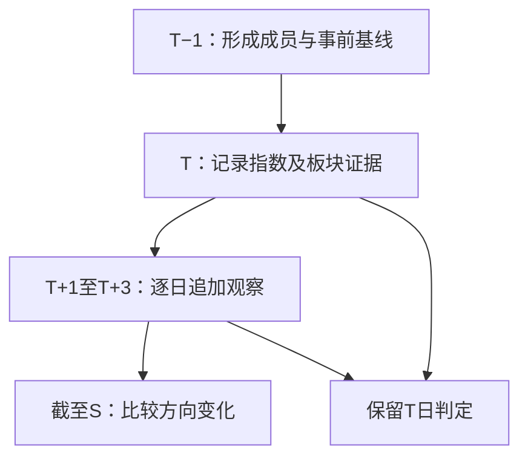

# 板块复盘：事件共振与调整逆势设计

状态：开发设计基线，P1日线首版已于2026-10-25实现；实际范围、库存覆盖与验证限制见 [实现与验证记录](sector-review-implementation.md)。本文确定产品边界、计算口径与验收要求，不表示策略已通过回测。原整理日期：2026-10-23。

本文保留原设计基线；下文“新增”路径、接口和字段的实际实现以代码及实现记录为准。开发遵循 [维护约定](../CONTRIBUTING.md)、[开发入口](DEVELOPMENT.md) 和相关领域文档；本次首版保持只读，不启动采集、回测或发布。

阅读导航：[页面设计](#3-页面与使用流程) · [数据契约](#4-时间成员和数据契约) · [逆势判断](#6-调整逆势确定性判定) · [共振判断](#7-事件共振指数锚点与后续响应) · [接口](#10-接口与返回结构) · [实施清单](#12-分阶段实施与核对清单) · [测试验收](#13-开发验收与测试矩阵) · [可靠性验证](#14-指标是否可靠研究与采样设计)。

## 1. 结论与目标

**新增独立的「板块复盘」页面 `/sector-review`，页面内设置「事件共振跟踪」和「调整逆势」两个视图。** 后端新增一个复盘领域服务，共享行情、分类、指标口径与缓存。ETF作为事件证据区，不另建ETF复盘页面。

工具回答三个问题：

1. 指数调整期间，哪些板块真正上涨，哪些只是跌得较少？这种表现出现了多少次，涉及多少成员？
2. 某个指数关键日到来时，哪些板块同日上涨并出现成交额扩张？哪些方向在随后1—3个交易日才走强？
3. 多个方向同时活跃之后，哪些方向继续跑赢、哪些转弱？它们此前已经强势，还是此前没有跑赢、此后才出现表现？

工具首先是**可核对的量价复盘工具**。行业动量、相对强度、市场广度等研究可以支持观察这些变量，但不能证明“金融上涨后两三天必有题材主线”，也不能证明原始文档中的阈值、打分和仓位结论。

### 1.1 为什么选择独立页面

| 方案 | 结论 | 项目内依据 |
| --- | --- | --- |
| 新建「板块复盘」核心页面 | 采用 | 查询对象是历史指数事件和板块证据，需要独立日期、观察截止日、规则说明及覆盖状态 |
| 放进现有「复盘」页 | 首版不采用 | [Review.tsx](../frontend/src/pages/Review.tsx) 以AI文字报告、历史报告、额度、提示词及推送为主体，日期与归档语义不同 |
| 分别加入行业分析、概念分析 | 仅提供后续跳转 | 两页主要展示当前行情、热度及轮动；复制历史规则会产生两套口径 |
| 做成独立插件或自定义策略 | 首版不采用 | 这是跨页面共享的基础复盘能力，需要统一历史数据与缓存，不是单个选股策略 |

与现有页面的关系：行业／概念分析用于发现当前方向，板块复盘用于核对历史证据，AI复盘可在以后引用这份结构化结果。首版不改变AI报告、通知、选股策略和模拟盘。

### 1.2 首版范围

| 首版必须交付 | 后续独立阶段 |
| --- | --- |
| 两个视图、行业／概念切换、行业层级、四个现有核心指数 | 扩展任意指数、行业ETF映射 |
| 指定事件日T，观察T至T+3的独立每日证据 | 自动扫描一段历史、维护事件档案 |
| 5／10／20／60日相对强弱与下跌日条件统计 | 风险调整后的残差动量、历史指数权重贡献 |
| 同日共振候选、延后走强、事前背景、群体广度 | 分钟同步、分钟先后关系、二波形态识别 |
| 可选宽基ETF成交额旁证；缺数据明确显示 | ETF自动采集配置、冻结快照、定时研究 |
| 数据不足、当前名册回看、规则及版本说明 | 通过样本外检验后再考虑排序模型或策略联动 |

首版没有0—100置信度、自动“主线确认”、真假共振判决和买卖／仓位指令。不同方向可以同时入选，也可以一个都没有。

## 2. 如何修订两份原始思路

输入材料为仓库根目录的 `逆势.md`、`共振.md`。它们保留为研究材料，不直接当作已验证规范。

| 原始说法或做法 | 设计处理 | 原因 |
| --- | --- | --- |
| 看持续跑赢，而非只看某天上涨 | 保留，并同时展示绝对收益 | 跌得少与实际上涨含义不同 |
| `逆势信号.rolling(N).mean()`当作下跌日胜率 | 改为同一N日窗口内，仅以指数下跌日为分母 | 原做法把指数上涨日也放进分母，回答的是另一个问题 |
| 指数下跌或落在−1%至+0.5%算弱势 | 不采用这个并集 | 实际几乎等于“指数小于+0.5%”，混入上涨环境 |
| 单日同步上涨、成交额扩张、成员共同上涨 | 保留为分别可见的证据 | 可以准确描述，不能直接推导未来收益 |
| 必须当日共振，次日确认 | 扩展为T至T+3响应窗口 | 允许用户提出的延后题材走强，后续不要求指数每天上涨 |
| 多日持续就提高置信度、最终确认主线 | 改为样本数、连续天数、逐日变化 | 时间更长不自动等于统计置信度更高 |
| 量缩说明筹码锁定，量增说明新资金流入 | 仅标注成交额收缩／扩张 | 交易额无法识别持有人意图，也不是净流入 |
| 低位最优、高位可能出货 | 位置可作描述，首版不加分或否决 | 需要独立研究，不能从位置直接推出收益或意图 |
| 大市值中军确认 | 首版改为事前成交额核心证据 | 当前没有可靠的全历史市值权重契约，不能拿最新市值替代 |
| 次日不涨即假共振 | 改为新增次日结果 | 次日结果不能改写T日已发生的量价事实 |
| 共振与缺口交集一定提高胜率 | 暂不接入交易规则 | 必须独立验证相对现有缺口策略的增量价值 |

## 3. 页面与使用流程

### 3.1 页面结构

按从上到下的顺序组织：

1. 标题「板块复盘」，简短说明「日线量价观察」。
2. 公共条件：行业／概念、分类来源、行业层级、基准指数、日期、返回最近完整日、刷新。
3. 数据边界条：请求日期、实际数据日期、名册口径、已评估／全部板块数、缺失原因。此区域常显，不放进截断的副标题。
4. 两个视图切换。
5. 对应视图的市场证据摘要、结果表及行内详情。
6. 可展开的“计算口径与版本”。

默认行业一级、上证指数、最近本地正式行情就绪的交易日。四个指数沿现有 [index_const.py](../backend/app/services/index_const.py)：上证、深成、创业板、科创综指。基准由用户明确选择，不能为每个板块事后选择最容易跑赢的指数。

行业支持一级／二级／三级；概念没有行业层级。板块标识由分类来源、字段、层级和值共同确定，不能仅用中文名称作为ID。

`availability`返回分类配置ID、字段、显示名称、kind和支持层级。`dimension_id`是服务端为“配置ID＋字段”生成的稳定、不透明标识，不是文件路径。多个来源时提供选择框；只有一个来源时展示名称，不让用户做无意义选择。

概念源可能包含融资融券、交易通道、指数成分等宽泛标签，不能全部称为产业题材。首版保留原始分类名与来源；可通过版本化的明确ID排除表隐藏非题材标签，同时显示被排除数量并允许查看。没有维护依据时默认不排除，不能用模糊名称匹配擅自改造成分。

### 3.2 「事件共振跟踪」视图

**使用顺序：选T → 看指数证据 → 看T日方向 → 推进观察日 → 核对成员。**

首版以手动指定T为主入口。在选定T后计算透明的指数形态标签，不要求先被某个算法认定为“重要行情”才能复盘。未来自动事件列表只是发现入口。

| 区域 | 内容与交互 |
| --- | --- |
| 日期控制 | 事件日T、观察截至日S。默认S=T；提供“观察到T+3或最近完整日”。首版限定T≤S≤T+3 |
| 指数证据 | 当日及事前5／20日收益、盘中最低价相对昨收、收盘位置、此前N日高点、成交额比 |
| 宽基ETF旁证 | 固定观察篮子内各ETF的收益、成交额比、总成交额及覆盖；无数据时独立缺失 |
| 响应概览 | T日共振候选数、各日首次走强数、可评估数；不强制只选一个题材 |
| 主表 | 板块、首次走强日、T日共振标签、事前20日相对收益、截至S累计相对收益、连续走强天数、广度差、成交额份额变化、覆盖 |
| 展开详情 | T、T+1、T+2、T+3四行证据；事前背景；固定成交核心；缺失原因 |

主表默认候选集合为“T日共振条件为真，或在T至S至少一天走强为真”的并集，按三值OR组合。候选筛选为“已入选／未入选／待判定／全部”，分别对应true／false／null／不筛选；“数据不足”是另一项可叠加筛选。已经价格走强、但成交额或60日背景不完整的板块仍保留在候选列表并标明不足，不能因辅助证据缺失被隐藏。

默认按截至S的累计相对收益降序，同值按稳定板块ID排序；不可计算项后置。排序只是浏览便利，不改变入选规则。用户可按首次走强日期、成交额变化等排序；不得将排序包装成综合可靠性评分。

### 3.3 「调整逆势」视图

**使用顺序：选截至日D和窗口W → 看指数阶段 → 看绝对与相对收益 → 核对下跌日表现和成员分布。**

| 主表列 | 用途 |
| --- | --- |
| 板块、区间状态 | 区分逆势上涨、相对抗跌、相对领涨等 |
| 板块与基准区间收益 | 避免把“少亏”误读成上涨 |
| 区间相对净值收益 | 回答是否累计跑赢 |
| 下跌日跑赢次数／可比较次数／指数下跌日总数 | 同时暴露条件分母与数据缺口 |
| 下跌日平均超额 | 区分频繁微幅跑赢与少数大幅表现 |
| 期间上涨成员比例、中位数收益 | 检查是否由少数极端个股拉动 |
| 成交额、覆盖数 | 补充活动程度和数据边界，不作因果判断 |

默认窗口20个交易日，可切换5／10／60日。单日状态单独显示，不把“今天抗跌”直接标为“持续抗跌”。默认展示逆势上涨与相对抗跌，允许查看其他状态；结果按区间相对净值收益排序。

选择某板块后可跳到事件视图，保留分类和基准。事件T仍需明确选择，不能把最佳反弹日自动当作事前已知的信号日。

### 3.4 细节、下钻与状态

- URL保存视图、分类来源、层级、基准、日期、窗口；事件模式额外保存T与S。刷新可恢复，后端仍校验所有参数。
- 改变日期、基准或分类时重置展开项；旧上下文响应不能覆盖新上下文。同一上下文刷新可保留上一份有效结果并标明刷新中。
- 桌面使用表格和行内详情；390px窄屏保留名称、状态、关键收益，其余展开。横向表格固定名称列并提示可滑动。
- 单项`true`／`false`表示已核实满足／不满足，`null`表示未知；组合`false`可能由一个必要条件为假即可确定，不代表其余证据齐全。数据完整性独立显示。缺失数值显示“—”，不做`null → 0`转换。
- 分别设计首次加载、刷新、有效零命中、筛选后为空、部分覆盖、全局不可用、请求失败和未登录状态。
- 打开历史成员遇到409版本冲突时保留原摘要，提示“数据已更新，刷新后查看”并提供刷新；刷新成功后清理旧详情，不自动拼接不同版本。

**历史下钻限制：** 现有 [StockPreviewDialogContent.tsx](../frontend/src/components/StockPreviewDialogContent.tsx) 默认最新日期范围；[DimensionMembersDialogContent.tsx](../frontend/src/components/DimensionMembersDialogContent.tsx) 会叠加当前市场快照。首版不能直接将它们当成T日证据。

首版在行内显示专门接口返回的历史成员证据，股票预览入口写明“查看当前行情”。如后续增加历史K线，给共享预览增加可选历史锚点并覆盖现有入口的回归测试，历史证据默认不显示锚点以后的数据。

## 4. 时间、成员和数据契约

### 4.1 时间定义

| 字段 | 含义 |
| --- | --- |
| `event_date = T` | 研究的指数事件日 |
| `view_as_of = S` | 事件观察截至日，只能使用不晚于S的数据 |
| `as_of = D` | 逆势视图的统计截至日 |
| `formation_date = F` | 确定计算成员集合的日期 |
| `qualification_date = Q` | 研究中某组全部入选证据最早同时可知的日期，与成员形成日、首次价格走强日分开 |
| `followup_date` | T、T+1、T+2、T+3，对应实际交易日 |
| `computed_at` | 本次计算时间，不是历史数据公开时间 |

所有日序列使用本地交易日历，北京时间口径。不能用自然日或“有行情的最后N行”代替连续N个实际交易日；缺日须保留缺失。

省略日期时可以解析最近正式行情就绪日，并返回实际日期。明确请求非交易日返回参数错误及可选的相邻交易日；日历覆盖外返回“日历不足”。明确请求某交易日但其数据不完整，保留该日并显示不足，不能静默回退到昨天。

默认完整日的验收范围沿盘后当前股票池政策：只排除维表明确声明的 `is_current=false`，缺列／空值不豁免缺行，并继续按上市日期核对目标日。该范围仅用于完整日发现，不用于裁剪下述历史研究集合；有有效历史数据的非当前标的仍可按形成日规则纳入研究。

T+3属于观测期限的工程默认值，不是已经证实的最佳周期。首版接口校验T≤S≤T+3，T和S不得晚于北京时间当前日期；明确请求尚未正式就绪的已到交易日可返回不足，不因缺数据改写S。界面仍可列出T+3以内尚未到来的交易日占位。更长的1／3／5／10日表现放到独立研究模块，不混进响应定义。

### 4.2 股票与板块的计算集合

目前行业／概念主要是当前分类快照。首版历史结果必须常显：**“当前分类名册回看历史行情”**，响应使用 `membership_basis=current_snapshot_backcast`。分类文件修改时间只表示本地观察时间，不代表历史生效日。

计算集合按以下顺序形成：

1. 读取一个明确分类来源，标准化股票代码、行业路径或多概念字段；同一板块内按股票去重。
2. 事件模式在F=T−1形成固定成员集。成员需在F及以前具备前20个交易日正式成交额和计算这20日收益所需的21个有效收盘价；不可用、历史不足、停牌等原因分别计数。
3. 逆势模式在所选W日窗口第一天的前一交易日形成成员集，按相同事前可用性规则处理；窗口内不再根据后续收益或数据完整性重新挑成员。
4. 同一次事件的T至T+3、事前背景及成交核心均沿用该集合。改变W会改变逆势模式的形成日和可评估成员，比较窗口时显示这个差异。
5. 成员筛选必须只依赖F及以前可获得的行情。当前分类回看仍有分类时点偏差，不能因为价格没有未来函数就声称整个研究无偏。

上述20日历史要求是首版的可比性政策，会排除新股和部分停牌股票；它不是收益阈值。报告原始成员数、纳入数、排除原因，不将排除项隐藏。若60日事前指标历史不足，只让60日指标为空，不反过来改变已形成的事件集合。

初始比较下限建议为5个形成成员；少于5个设置`eligible_for_comparison=false`，仍可在“全部”中看事实与明细，但不进入默认候选榜和事件候选计数。不要把这个政策排除混为价格条件失败或行情缺失。这是工程默认值，须根据覆盖审计调整并版本化，不解释为统计显著性。

### 4.3 缺失和停牌

成员形成后出现缺失，不能删除该成员并悄悄重新归一，不能把缺失收益补零。明确停牌、尚未上市、供应商缺失、非正式快照、异常价格要分别标记。

首版采用保守口径：正式板块聚合需要该指标所需的固定成员输入完整；不完整时，相关聚合及判断为`null`。可以另外展示“可见成员统计”，但必须有独立字段、分母和“部分样本”标识，不能替代正式聚合参与筛选。某个指标缺失不连带否决其他独立且数据完整的指标。

每日“证据完整”还要求基准当日成交额及20日成交额比有效；其缺失不改写已完整的价格走强事实，但该日及相应行的完整性保持不足。成员窗口收益在摘要和明细共用同一次连续交易日计算：窗口任一日价格缺失，该成员的窗口收益不可计算；原形成成员分母不变，上涨比例及中位数不能仅用剩余可见成员重算。

这可能降低部分日期的可评估覆盖。P0必须量化影响；若覆盖过低，先修复数据或单独设计有依据的停牌处理规则，再变更规则版本。不能临时以80%覆盖作为正式完整性的替代，也不能为了榜单好看而偷偷更换分母。

历史正式数据也不等于有完整的当时证券名册。首版只能核对当前名册内可见范围，不承诺包含历史退市成员。

### 4.4 金融字段

| 项目 | 契约 |
| --- | --- |
| 股票收益价格 | 同一版本前复权close，不能与raw_close混用 |
| 指数、ETF | 独立资产路由及其标准化日线；按资产元数据识别，不能只猜代码 |
| 成交额 | 原始人民币元；不随价格复权，不用成交量相加替代成交额 |
| 收益、比例 | API统一小数制，0.01表示1%；展示层格式化 |
| 两个收益的差 | 小数差；界面显示“百分点”，区别于相对净值收益 |
| 分母为零 | 返回不可计算及原因，不返回0、无穷大或任意极大值 |
| 行业指数 | 首版为自己计算的固定成员等权序列，明确不是供应商官方行业指数 |

正式股票行情遵循 [daily_coverage.py](../backend/app/services/daily_coverage.py) 与 [盘后流程](postmarket-pipeline.md)：非空`quote_ts`属于快照证据，不能仅凭15:00之后的时间戳当作正式日线。旧schema无该列时沿项目标准扫描器兼容；还须检查价格、日期、覆盖和来源，不能只检查这一列。

目前部分完整性显示函数对尾盘快照有较宽口径，新工具应采用正式盘后契约，不能直接把“尾盘已有数据”当成“已完成正式复盘”。

## 5. 公共指标与公式

记板块固定成员集为M、人数为m，股票i在交易日d的前复权收盘价为C，基准日收益为r_b,d。

### 5.1 收益和相对强度

```text
个股日收益：r_i,d = C_i,d / C_i,d-1 - 1
板块日收益：r_s,d = mean(r_i,d, i∈M)
板块等权净值：NAV_s,d = NAV_s,d-1 × (1 + r_s,d)
窗口收益：R_s,W = product(1 + r_s,d, d∈W) - 1
区间相对净值收益：RS_W = (1 + R_s,W) / (1 + R_b,W) - 1
日超额：e_s,d = r_s,d - r_b,d
```

该序列相当于固定名单、每日等权重置的理论观察指数，不包含成本，不能直接作为可交易策略净值。不能用“每日超额相加”代替区间相对净值收益。

独立展示成员的日收益中位数，以及窗口个股累计收益的中位数和上涨比例；个股窗口收益用各自价格计算，不使用每日中位数复合。

### 5.2 成交额与成交额份额

```text
板块成交额：A_s,d = sum(A_i,d, i∈M)
日常滚动额比：amount_ratio_rolling20(d)
  = A_s,d / mean(A_s,d-20 ... A_s,d-1)
事件固定额比：amount_ratio_event20(d; T)
  = A_s,d / mean(A_s,T-20 ... A_s,T-1)
```

所有均值排除评价当日；事件的T至T+3固定使用T前基线，避免观察尺子每天改变。界面分别写“较此前20日”和“较事件前20日”，不共用一个含糊的“量比”字段。指数与ETF按相同方式独立计算。

价格上涨本身也会推高成交额，所以准确名称为“成交额扩张”。它不等同于成交股数扩张、换手率上升或净资金流入。

市场比较集合U在同一形成日，从本地证券维表识别的A股范围按相同事前历史可用性政策形成，不限于拥有某个概念标签的股票，并须包含M。默认范围为沪、深、北交易所的人民币普通A股，包括可用历史充分的ST股票，排除B股、基金、ETF、债券及无法确认资产类型的代码；不拿最新ST状态回溯剔除历史成员。缺某交易所覆盖时如实显示实际范围，不声称覆盖完整A股。

响应明确交易所范围、原始及有效股票数、名册口径；界面标为“可比较A股样本”，只有覆盖得到证明才可简称全市场。不能与某个指数的成交额混用。

```text
板块成交额份额：share_s,d = A_s,d / A_U,d
事件份额变化：share_delta_event_s,d = share_s,d - mean(share_s,T-20 ... share_s,T-1)
逆势视图份额变化：share_delta_rolling_s,d = share_s,d - mean(share_s,d-20 ... share_s,d-1)
```

M不是U的子集、所需U成交额缺任一成员或口径不一致时份额及变化为空；U成员收益不完整时市场广度及广度差为空，不因此清空仍完整的板块自身指标。每一历史基线点也要满足同样要求。概念成员重叠，多个概念份额不能相加当作资金分配总额，也不能把重叠概念当作独立观察。

### 5.3 群体广度与核心成员

```text
上涨广度：breadth_up_s,d = count(r_i,d > 0) / m
上涨且成交额扩张广度：
  count(r_i,d > 0 AND A_i,d / pre20_mean_amount_i > 1) / m
相对市场广度：breadth_diff_s,d = breadth_up_s,d - breadth_up_U,d
```

其中`pre20_mean_amount_i`在事件模式为固定T前20日均额，在逆势模式为评价日d之前20日滚动均额；板块、成员和市场对照使用同一种基线模式。逆势主表展示D日额比及份额变化，窗口内逐日明细按各自d计算，不引用不存在的事件T。

普涨90%的市场里，一个仅60%成员上涨的板块不能仅因超过60%就被描述为突出。表中同时展示板块广度和广度差。

事件成交核心为T前20日平均成交额前K名，首版K=5、最多取全部成员，固定至T+3；同额按股票代码排序。显示核心股当日收益、额比、参与上涨家数及其成交额占板块比例。不能用T后交易额反选“当时的核心”，也不能称其为历史大市值中军。

K只控制证据展示，不是入选硬门槛。成交集中度高提示结果可能集中于少数股票，不自动推出操纵、抱团或出货。

## 6. 调整逆势：确定性判定

### 6.1 单日与区间分类

对完整可计算的区间收益，按以下互斥条件分类；单日使用相同关系但独立命名。

| 条件 | 标签 |
| --- | --- |
| R_b < 0 且 R_s > 0 | 逆势上涨 |
| R_b < 0 且 R_s = 0 | 调整中持平 |
| R_b < 0 且 R_b < R_s < 0 | 相对抗跌 |
| R_b < 0 且 R_s ≤ R_b | 调整中未跑赢 |
| R_b > 0 且 R_s > R_b | 相对领涨 |
| R_b > 0 且 R_s ≤ R_b | 上涨环境未跑赢 |
| R_b = 0 | 基准区间持平，另示板块涨／平／跌 |
| 关键输入不足 | 待评估 |

首版“持平”采用数值相等的语义；浮点容差只处理机器误差，不新增±0.5%等未验证的“震荡区间”。如未来增加经济意义的横盘带宽，应作为独立规则版本。

### 6.2 指数下跌日的条件统计

在同一个W日窗口内，先找出所有基准下跌日D_all；再取基准和板块收益都有效的日期D_valid。

若W内基准本身缺日，`D_all`的完整数量未知，不能将已知下跌日数量冒充全部；只能显示“已知下跌日”，并把完整窗口统计标为不足。

```text
n = count(D_valid)
k = count(r_s,d > r_b,d, d∈D_valid)
down_win_ratio = k / n
down_mean_excess = mean(r_s,d - r_b,d, d∈D_valid)
```

n=0时返回空值。展示“跑赢k/n天；指数下跌共N天”，同时返回有效覆盖。仅在n=N且N>0时可称“该窗口下跌日统计完整”；否则明确是可比较子样本。n很小时标明样本少，不给高置信度。

不把k/n称作交易胜率。不默认用55%或60%划分主线，也不因为60日窗口长于20日就升级评价。低波动、低beta板块也可能长期抗跌；能否在上涨阶段领涨是另一个待观察问题。

### 6.3 事前逆势背景

事件视图显示截至T−1的5／20／60日绝对收益、相对收益与下跌日统计。使用事件固定成员，不能在T+3重新挑选T前最强的名单。

- T前20日基准负收益、板块正收益：标“事前逆势上涨”。
- 两者均跌而板块少跌：标“事前相对抗跌”。
- T前20日相对收益非正、事件后首次走强：标“此前未跑赢，事件后走强”。
- 其他情况显示原始收益，不强行贴“新启动”或“老主线”。

事前逆势是比较维度，不是事件候选的必要条件，否则会漏掉此前较弱、之后走出的方向。

## 7. 事件共振：指数锚点与后续响应

### 7.1 指数事件的可观察依据

首版在用户指定的T上计算以下标签。允许同一天同时满足多个标签，合并为同一事件的多条证据。

| 标签 | 精确条件 | 不能推导的结论 |
| --- | --- | --- |
| 下探后收复昨收、成交额扩张 | L_T < C_T-1，C_T > C_T-1，指数滚动20日额比>1 | 不等于“恐慌出清”或已确认底部 |
| 回落后上涨、成交额扩张 | 截至T−1的5日收益<0，T日收益>0，指数额比>1 | 不等于“严重超跌” |
| 突破此前N日收盘高点、成交额扩张 | C_T > max(C_T-N ... C_T-1)，指数额比>1 | 不等于已经验证长期横盘或有效突破 |

首版N固定为20，是工程观察窗口；60日等替代窗口留作研究，不提供尚未接入接口的可选项。高点基准必须排除T。收盘高点与盘中最高价不同，接口和文案必须一致。

可补充展示 `L_T / C_T-1 - 1`、`(C_T-L_T)/(H_T-L_T)` 和事前回撤；H=L时收盘位置为空。首版不拿某个未经验证的下影线长度或回撤阈值筛“重要行情”。

金融板块上涨、宽基ETF活跃可作为并列证据；不设为事件必需条件，也不将其解释为“资金先拉金融再尝试题材”的因果证明。二波、长期横盘、超跌程度的自动识别留待独立研究。

### 7.2 T日共振候选

将各条件分别返回，再给出描述性组合：

```text
same_day_up = (r_b,T > 0) AND (r_s,T > 0)
amount_expansion = (index_amount_ratio_rolling20(T) > 1)
                   AND (sector_amount_ratio_event20(T;T) > 1)
majority_up = breadth_up_s,T > 0.5
daily_resonance_candidate = same_day_up AND amount_expansion AND majority_up
relative_lead = r_s,T > r_b,T
```

这些条件分别表达同日上涨、超过历史成交额基线、过半成员上涨。它们不是盈利概率模型。0.5%、1%、1.2倍、60%等原材料阈值不进入首版默认规则。

板块跑赢指数是单独标签，不是所有同日共振候选的必需条件。这样既能看到普涨中参与的方向，也能分辨其中相对领涨的方向。日线同日发生不能称为分钟同步。

三值逻辑统一为：某个必要条件明确为假，组合可为假；没有明确假、但存在未知时为未知；全部为真才为真。条件明细必须保留，以区分“不满足”和“数据不足”。

### 7.3 T至T+3的响应

定义每天独立的“走强”：

```text
strength_d = (r_s,d > 0) AND (r_s,d > r_b,d)
earliest_observed_strength_date = T至S内最早观察到 strength_d 为真的日期
confirmed_first_strength_date = 仅当上述日期之前各日均明确为假时，取该日期；否则为空
strength_streak = 截至S的连续走强天数，按下述完整性规则返回
```

- 确定的首次日期为T：标“当日走强”；为T+1至T+3：标“延后走强（T+n）”。
- 后续指数可以下跌；板块上涨且跑赢仍可以走强。
- “走强”与“成交额扩张”“过半成员上涨”分列。首次价格走强不自动称为完整量价共振。
- 截至S都不满足且每日完整：标“尚未观察到走强”；S<T+3时同时标“观察窗口未结束”。
- 首次真之前有缺失日：仅返回`earliest_observed_strength_date`，确定首次日期为空；只能说“最早已观察到T+n走强，首次日期不确定”，不能把缺失当假。
- S日为假，连续天数确定为0，即使更早有缺失；S日未知，连续天数为空，不能沿用此前连续值。S日为真则向前计数，直到明确假或T边界可确定天数；若先遇未知，只返回从S往前已连续为真的下限k及`streak_complete=false`，显示“至少连续k日”。

每一天显示收益、相对收益、固定额比、广度、广度差、成交额份额、覆盖及各条件。相对收益、广度、成交额各自较前日的变化分别展示，不压缩成一个“承接评分”。

累计收益以T−1收盘为起点，计算截至S的板块及基准收益与RS，并标“事件累计表现”。这部分包含已经发生的响应，不能作为延后走强的预测收益。

### 7.4 防止事后改写

同一输入版本和规则版本下，先截断到T计算，再加入T+1至T+3，T日成员、基线、核心排序及条件结果必须相同。



示例：甲板块T日共振、T+1落后；乙板块T日未走强、T+2才首次走强。到T+2可以描述甲优势减弱、乙延后走强，但T日视图仍只能显示当时的甲与乙。不能把乙补进“当天选出的主线”，也不能把甲T日的量价事实改成未发生。

相邻指数事件允许重叠，以基准、T和规则版本识别；界面提示重叠，不把同一板块的后续上涨自动归因给其中一个事件。

## 8. 宽基ETF怎样接入

TickFlow官方SDK提供ETF universe、实时报价与K线能力；本项目已有 [index_sync.py](../backend/app/services/index_sync.py) 的ETF维表／日线同步、仓库ETF读接口及 [ordinary_minute.py](../backend/app/services/ordinary_minute.py) 的资产路由。**技术路径存在，不代表当前账号、路由和本地ETF数据已经就绪。**

首版ETF区使用日线成交额，不需要tick级逐笔成交或全市场分钟能力。普通分钟、全市场分钟、逐笔成交是不同能力，不能从“能取ETF行情”推断“具备逐笔成交历史”。

| 项目 | 设计 |
| --- | --- |
| 观察对象 | 固定的宽基ETF篮子，按跟踪指数分组；沪深300、中证500、中证1000等仅为可选类别 |
| 选取方式 | 显式代码、资产类型、跟踪标的、来源说明、配置版本及生效时间；不按事件后的涨幅选产品 |
| 初始状态 | 未配置篮子或没有数据时显示未提供，不自动选名称相似的ETF |
| 个体指标 | 当日收益、成交额、T前20日固定成交额比 |
| 汇总指标 | 相同固定篮子的成交额合计及相对自身历史基线的变化；附有效只数／全部只数 |
| 禁止混算 | 不将ETF成交额加到股票或指数成交额中，不随意把ETF价格相加，不叫申购净流入 |
| 缺失处理 | 不阻断股票板块复盘；ETF区独立显示数据不足 |

固定篮子某只ETF缺失时，完整篮子的汇总成交额与额比为空；可以另列“已覆盖ETF成交额”，但不能拿它与完整篮子的历史基线比较。ETF自身处于发布中或版本不可读时，只降级ETF区，股票与指数主结果仍可计算；不能因可选旁证失效而使全页不可用。

篮子是市场活动的旁证，不代表全市场ETF全集；多个跟踪相同指数的ETF不是独立风险证据。行业／主题ETF需要额外可靠映射，首版不根据名称猜对应板块。跨境ETF、标的范围不同或显著溢价产品不能直接替代A股板块收益。

若需要补采，复用collector的能力路由、底层ETF同步与任务框架；GET复盘请求不发起采集、不绕过权限。当前数据页主要提供整类ETF开关，内部同步函数虽支持选定代码，但尚不能视为已有公开的篮子定向采集入口。P2另补有界的篮子／选定标的任务入口，避免为了几个宽基ETF触发整类采集。观察篮子配置、盘后同步和限额在该阶段独立实现，不在本轮修改环境配置。

## 9. 数据与代码接入

### 9.1 可用基础与当前缺口

| 输入 | 当前项目能力 | 首版处理 |
| --- | --- | --- |
| 股票原始／enriched日线 | 已有 | 按需读取正式数据、有界窗口、明确复权 |
| 四个核心指数日线 | 已有 | 基准数据缺失时相对条件不可评估 |
| 行业／概念分类 | 当前快照为主 | 当前名册回看，显示分类指纹与观察时间 |
| 交易日历 | 已有本地状态与覆盖 | 覆盖外不推测，不用工作日替代交易日 |
| ETF日线、维表 | 代码路径已有，本次检查未见就绪的独立ETF数据集 | 可选旁证，开发前重新核查本地实际覆盖 |
| 历史分类名册 | 未形成完整时点契约 | 不能支持无偏的历史板块成分研究 |
| 全部成分与指数同日分钟 | 本地覆盖不一致 | 首版不做分钟同步与领先因果分析 |

本次检查发现最新本地股票日期存在盘中快照，不能仅按最大日期默认可复盘。库存会变化，开发前须重新审计日期范围、正式／快照比例、股票／指数交集与ETF覆盖，不将这次库存结论硬编码。

### 9.2 建议模块

| 拟新增或修改路径 | 职责 |
| --- | --- |
| `backend/app/services/sector_review_rules.py`（新增） | 纯计算：聚合、公式、条件、逐日事件响应；无网络、文件及缓存副作用 |
| `backend/app/services/sector_review.py`（新增） | 日期、分类、数据读取、覆盖、版本、缓存编排 |
| `backend/app/api/sector_review.py`（新增） | GET路由、认证、参数校验与响应模型；不做全量计算 |
| `backend/app/tickflow/repository.py` | 必要时增加正式日线窄列只读查询；复用标准扫描与资产路由 |
| `backend/app/main.py` | 注册核心路由，沿用登录访问规则 |
| `frontend/src/pages/SectorReview.tsx`（新增） | 页面状态、条件、两个视图和结果编排 |
| `frontend/src/components/sector-review/`（按需新增） | 结果表、事件日证据、历史成员详情 |
| `frontend/src/lib/api.ts`、`queryKeys.ts` | 类型、请求封装、查询键与数据更新失效 |
| `frontend/src/router.tsx`、`components/Layout.tsx` | 路由与侧栏入口，纳入核心路由保留集合 |
| `frontend/src/pages/settings/MenuSettings.tsx` | 菜单列表、分类及隐藏／排序兼容 |

首版作为核心模块接入。注册前核对 [扩展说明](secondary-development.md) 的核心路径保留和实际类型，避免与自定义路由冲突。当前无需新增provider数据集或插件依赖。

### 9.3 可以复用，但不能直接照搬的入口

| 现有入口 | 限制与处理 |
| --- | --- |
| `KlineRepository.get_daily_batch()` | 会经过`get_enriched_latest()`，冷启动可能预热／重算，还需防止最新快照覆盖；不能未经审查直接用于严格只读历史GET |
| `get_index_daily()`、`get_etf_daily()` | 优先窄列快路径；核对旧ETF存于index目录的兼容路径，避免重复计入 |
| `get_matrix_data_generation()` | 用于识别发布中状态；底层可能初始化标记。新读路径读取已有标记，旧库返回可解释降级，不在GET创建标记 |
| `scan_daily_parquet()`、`scan_enriched_parquet()` | 沿用项目schema兼容；不能在API中直接扫Parquet |
| `market_overview_builder`的分类工具 | 可参考字段、代码、层级解析；timeseries读取须限定截至日，不能默认取最新行 |
| `ExtConfigStore.load_all()` | 旧配置可能触发迁移写盘；只读加载器须使用无迁移路径 |
| `rps_rotation._load_concept_map_df()` | 缓存未包含数据目录与分类版本，不直接复用该缓存 |
| `SnapshotCache` | 可复用同键单飞与有界缓存，但新键必须包含所有历史输入版本 |
| `review_publication` | 当前市场摘要不足以冻结成员和规则；不把它当作历史板块证据档案 |

这些限制来自当前调用链核查。实现前沿实际版本再次确认；复用解析逻辑时优先提取窄小公共函数，避免为新页进行无关大重构。

## 10. 接口与返回结构

### 10.1 拟定接口

| GET接口 | 参数与用途 |
| --- | --- |
| `/api/sector-review/availability` | 返回日历／正式数据可用范围、分类来源、指数和可选ETF状态，不拉远端行情 |
| `/api/sector-review/countertrend` | `as_of`、`window`、`benchmark`、`dimension_id`、`kind`、`level`；返回全部板块摘要 |
| `/api/sector-review/event` | `event_date`、`view_as_of`、`benchmark`、`dimension_id`、`kind`、`level`；返回T至T+3全部板块摘要及逐日证据 |
| `/api/sector-review/members` | `mode=event|countertrend`、对应模式的全部上下文、`sector_id`、`snapshot_id`、分页；事件模式一次返回T至S各日证据，逆势模式返回D日及W窗口证据，不能合并当前报价 |

视图按需查询，各自一次批量摘要，不按板块发请求。切回已缓存视图可复用结果。展开成员才发一个详情请求；摘要已包含核心成员与四日简表，避免每次展开都重复全市场计算。

参数限定可选窗口、合法分类、有限日期范围和分页上限。手动刷新只重新读取本地结果。非法参数返回422；未登录沿用现有认证错误；数据不足采用业务状态与原因，不伪装成服务器异常或空命中。

### 10.2 共同响应字段

| 字段 | 约定 |
| --- | --- |
| `status` | `ready / partial / unavailable`，与是否命中分离 |
| `context` | 请求／有效日期、事件T与S或窗口W、基准、分类、规则参数 |
| `rules_version` | 语义、默认参数或缺失政策改变即升级 |
| `snapshot_id` | 本次输入与规则摘要ID，用于明细一致性；不等同于持久化历史档案 |
| `calculation_basis` | 首版`recomputed`，以后真实冻结档案另用`archived` |
| `membership_basis` | 首版`current_snapshot_backcast`；历史时点名册就绪后才能增加新类型 |
| `membership_observed_at / membership_fingerprint` | 本地分类观察时间与指纹；不是历史生效时间 |
| `input_versions` | 股票／指数／ETF数据版本、日历、分类、规则和篮子版本 |
| `coverage` | 全部／可评估板块、原始／形成／有效成员、缺失原因计数 |
| `eligible_for_comparison`（行字段） | 成员数等比较政策是否满足；独立于条件真假与数据完整性 |
| `rows` | 板块摘要、三值条件、事实指标、逐日观察 |
| `computed_at / warnings` | 计算时间与面向用户的具体数据说明，不含密钥或完整配置 |

成员详情带 `symbol`、`name`、`formation_eligible`、`exclusion_reason`、日期、价格收益、成交额、额比及核心标记；不能在浏览器重新计算另一套判定。规则ID同时返回便于测试，界面使用中文名称。

### 10.3 可计算性和观测状态

每个每日观测分别给出：`future / not_yet_observed / data_missing / partial / ready`等状态及具体原因。未到交易日、超出用户S、日历缺失、快照未正式完成不能统称“承接失败”。

详情请求的`snapshot_id`与当前数据不一致时返回409和“数据已更新，请刷新”，不能把新成员悄悄接到旧摘要上。API无需接受客户端传入的任意文件路径，分类ID只能解析到已注册的数据源配置。

## 11. 只读边界、缓存和性能

### 11.1 首版运行边界

web服务读取本机已有数据并计算；不向collector转发普通查询、不触发供应商请求、不补数据、不重算enriched、不迁移配置、不发布复盘档案。已有本地数据的浏览不要求用户当前仍有远端采集权限；缺失时引导到现有数据能力配置。

普通登录用户可查看共享行情复盘。采集、配置、保存档案等写操作留给既有权限模型，不由新GET隐式触发。应用启动时的既有初始化与GET调用时的副作用应分开测试。

### 11.2 缓存一致性

缓存键至少包含：数据目录、模式、T／S或D／W、基准、分类来源／层级、成员政策、规则版本、股票／指数／ETF版本、分类与日历指纹、ETF篮子版本。

- 构建前后复核输入版本；发生变化则丢弃结果并有限重试，不能发布跨版本拼接的数据。
- enriched正在发布时返回暂不可用或保留同上下文上一份完整结果并明确陈旧状态。
- 旧库没有generation标记时使用只读文件签名并标记版本保障较弱；若不能得到一致输入则返回不可用，不在读路径补写标记。
- 有界内存缓存复用 [snapshot_cache.py](../backend/app/services/snapshot_cache.py)，避免锁内磁盘扫描和网络请求。
- 前端查询键集中在`queryKeys.ts`，包含所有业务参数。股票日线／enriched、指数／ETF日线、分类、日历及篮子配置变化失效对应结果。
- 不加入高频`quotes_updated`失效列表。分类和日线修订也必须跨进程可见，不能只清当前web内存。

当前名册或复权数据修订后，重新计算的历史结果可以变化，必须显示新的输入版本；这不是当时的冻结快照。只有输入版本固定时才要求截断不变性。

### 11.3 性能目标

只取必要交易日与字段，股票一次批量读取，用Polars按成员映射聚合；不在每个板块循环读取全市场历史。60日统计所需预热及前收盘要纳入范围，但不预热所有技术指标。

开发时固定约6000股票、400概念及80—100交易日的测试规模，记录冷／热请求耗时、峰值内存、仓库调用次数与返回体积。冷请求5秒以内、缓存请求500ms以内可作为初始体验目标，须记录实际硬件再评审，不宣称当前已达到。

摘要不返回所有股票全量日线，成员分页。并发同键请求单飞，页面快速切换取消或忽略旧请求。超过目标先定位读放大与重复计算，再决定是否异步任务化。

## 12. 分阶段实施与核对清单

### P0：数据与规则核对

- [x] 确认本文作为开发基线，记录版本；任何阈值调整说明用途与依据。
- [x] 审计股票／指数／ETF正式日线、交易日历和分类覆盖，不修改原始材料。
- [x] 统计固定成员与严格缺失政策下可评估板块比例，检查新股／停牌排除影响。
- [x] 用少量固定样例手算公式，形成可复核预期值。
- [x] 确认哪些日期只能当前名册回看，哪些数据不足以进行事件研究。

交付：数据审计和规则样例。不能以“供应商支持接口”代替本地数据就绪验收。

### P1：首版日线复盘

建议顺序：只读仓库查询与成员契约 → 纯计算规则 → 服务／缓存／API → 页面／路由／下钻 → 联调与完整验证。

- [x] 实现逆势视图及其单日／窗口分离。
- [x] 实现人工指定T、指数证据、T日共振和T至T+3逐日响应。
- [x] 首次响应、连续天数和当前变化分开表达。
- [x] 实现当前名册回看、三值判断、覆盖与缺失原因。
- [x] ETF区可降级；不得因ETF缺失导致股票复盘不可用。
- [x] 历史明细不混入当前行情。
- [x] 完成后端全量测试、前端各测试运行器检查、构建、浏览器交互及性能记录（浏览器为隔离正式样例，HTTP监听限制见实现记录）。
- [x] 同步仓库地图、相关领域文档及接口说明，标明实际实现与本文的差异。

完成标准：在本地已有正式数据上能复现指定日期的两类复盘，用户能逐条核对命中和不足原因。**这一阶段完成不等于预测能力验证完成。**

### P2：可选ETF准备与事件发现

- [ ] 建立版本化宽基ETF观察篮子，核对跟踪标的与数据权限。
- [ ] 复用collector底层ETF同步与任务框架，增加有界篮子补采入口，补足选定ETF维表、日线和基线窗口；不将现有整类开关当作定向采集。
- [ ] 增加有界历史的指数事件候选列表，沿第7节定义；保留人工T入口。
- [ ] 测试同日多标签、连续事件、重叠窗口、无候选与缺指数成交额。
- [ ] 事件列表展示触发条件和参数，不能只显示“重大反转”。

### P3：历史验证与前向观察

- [ ] 按第14节做事件研究和消融，先锁定规则再看留出样本。
- [ ] 报告覆盖、样本、重叠、分类偏差与失败案例。
- [ ] 无增量价值的过滤不强行保留；只有独立证据支持才改变默认规则。
- [ ] 建立前向观察记录，补足当前名册回看无法解决的偏差。

### P4：真实冻结档案及可选联动

只有需要保留“当时看到什么”时，才增加collector写入的事件档案。归档应包含规则、成员、核心名单、基线、输入版本及当日结果；后续观察追加版本，不能覆盖原始T日记录。

首版不新增盘后步骤。将来加入冻结时，必须遵循 [postmarket-pipeline.md](postmarket-pipeline.md) 的股票正式日线→因子→enriched→核心指数／可选ETF→完整性验收→分类等依赖，依赖就绪后才能冻结。同步更新该文档以及重试、取消、互斥、失败不发布、SSE与缓存测试；不能让GET调用`publish_review_if_ready`完成归档。

分钟研究、AI引用、策略过滤与缺口联动都在此后独立评审，不绑定首版交付。

## 13. 开发验收与测试矩阵

所有测试使用隔离目录和固定样例，不能让普通测试访问真实行情接口或改写用户数据。

| 编号 | 场景 | 必须成立的结果 |
| --- | --- | --- |
| Q01 | 基准−5%，板块−2%／+1% | 分别为相对抗跌／逆势上涨，显示绝对收益 |
| Q02 | 两日复合收益与每日超额相加不相等 | RS按相对净值公式计算 |
| Q03 | 20日仅4个指数下跌日，其中跑赢3日 | 显示3/4及完整覆盖，不能显示3/20 |
| Q04 | 无下跌日、仅1个下跌日、缺板块数据、基准自身缺日 | 分别为空、样本少、子样本、下跌日总数未知，不误报完整 |
| Q05 | 基准上涨／持平、板块跑赢 | 不误标为调整逆势 |
| Q06 | 今日巨额成交 | 当日不进入前20日均值，T后仍用固定事件基线 |
| Q07 | 基准小涨、板块小涨、双额比>1、过半上涨 | 可为描述性共振，不额外夹入0.5%／1%门槛 |
| Q08 | 单股大涨、其余多数下跌 | 等权平均与中位数／广度分别正确，不称群体上涨 |
| Q09 | 市场90%上涨、板块60%上涨 | 广度差−30个百分点，不能描述为广泛领涨 |
| Q10 | T日未走强、T+2首次走强；T+2指数下跌 | 正确记录延后走强，不要求当天指数上涨 |
| Q11 | 首次真前缺数据、连续段中缺数据、末日未知／假 | 区分观察到与确定首次；末日未知连续数为空、末日假为0，不能沿用旧值 |
| Q12 | 先截断T，再加入T+1至T+3 | 同输入版本T日成员、基线、核心和判断完全不变 |
| Q13 | T后成员缺失、后加入分类或事后成交排名变化 | 不回头删除T成员、不改变事前核心；分类变化返回新版本 |
| Q14 | 节假日、日历边界、基准缺交易日 | T+n按日历，缺日不能被后面的有效数据补足 |
| Q15 | 15:30快照、旧schema无quote_ts、异常价格 | 快照不替代正式数据；旧schema兼容但仍校验其他字段 |
| Q16 | 复权修订、股票拆分、amount单位 | 收益价格一致，成交额不复权，小数和百分点无混用 |
| Q17 | ETF无数据／篮子部分缺失／发布中／有legacy存储 | 主功能可用、完整篮子汇总不缩减分母、无重复计入或私自换源 |
| Q18 | 多概念重复成员、同名板块、不同数据目录 | 板块内去重、身份明确、缓存相互隔离 |
| Q19 | GET冷缓存、旧分类配置、缺generation标记 | 不联网、不迁移、不写数据、不重算指标 |
| Q20 | 读取过程中版本变化、同键并发、跨进程修订 | 不发布混合版本，同键单飞，结果正确失效 |
| Q21 | S=T与S=T+3切换、S超出T+3、请求乱序 | 不泄露未来观察、不混入旧上下文，超期参数拒绝 |
| Q22 | 摘要后数据更新再打开成员 | 返回版本冲突或要求刷新，不悄悄混用 |
| Q23 | 零命中、无数据、部分数据、筛选为空、API失败 | 五类状态区分，空值不显示为0；已走强但辅助字段缺失仍可入选 |
| Q24 | 历史成员与当前行情差异显著 | 历史详情始终使用对应日期，当前预览明确标注 |
| Q25 | 侧栏菜单隐藏排序、桌面与390px窄屏 | 入口兼容、筛选及明细可操作 |
| Q26 | 日线／分类更新与实时quote事件 | 前者失效新查询，后者不高频重算历史 |

建议新增后端规则、服务、API、只读仓库／缓存测试，名称随实际模块确定；复用现有本地读取、共享运行、数据完整性和认证测试。前端新增页面交互与查询失效测试，必要时补共享历史预览回归。

实施验证的最低命令基线如下；本次实际结果见 [实现与验证记录](sector-review-implementation.md)：

```bash
# 项目根进入后端：全量测试；Ruff列出所有实际变更的Python文件
cd backend
uv run --frozen pytest tests -q
uv run --frozen ruff check app/services/sector_review.py app/services/sector_review_rules.py app/api/sector_review.py
```

```bash
# 项目根进入前端：先运行新页及受影响测试，再运行全部适用Vitest测试
cd frontend
pnpm exec vitest run src/pages/SectorReview.test.tsx
pnpm exec vitest run --exclude src/lib/neighborPrefetch.test.ts --exclude src/components/DimensionMembersDialog.test.ts
pnpm build
```

当前有独立`node:test`文件，不能因为从Vitest排除就算完成全量验证。在支持类型剥离的Node环境，从前端目录执行：

```bash
node --experimental-strip-types --test src/lib/neighborPrefetch.test.ts src/components/DimensionMembersDialog.test.ts
```

按 [DEVELOPMENT.md](DEVELOPMENT.md#验证入口) 重新盘点所有测试的运行器，其他新增同类文件也须覆盖。若环境只支持Node 20，应先确认现有兼容运行方式并报告限制，不能直接宣称全量通过。

最后在项目根执行`git diff --check`，核对未改用户配置、数据及原始材料。真实行情采样和测试套件分开记录；测试通过证明实现符合规则，不证明规则有预测收益。

## 14. 指标是否可靠：研究与采样设计

### 14.1 分成三个验收层次

| 层次 | 核对问题 | 合格证据 |
| --- | --- | --- |
| 计算正确性 | 数据、单位、分母、日期是否正确？ | 固定样例、逐行核对、无未来数据测试 |
| 描述价值 | 能否客观区分抗跌、普涨、群体领涨、延后走强？ | 包含成功与失败的多类事件回看、成员证据 |
| 预测增量 | 比简单涨幅／相对强度排序能多预测什么？ | 预先锁定规则、时间外样本、对照及不确定性区间 |

前两层成立就可以成为有用的复盘工具；第三层没有成立前不宣称策略可靠、提高胜率或能识别未来主线。

### 14.2 样本选择

- 首先手工核对约10—20个案例，覆盖下探回升、突破、普涨、指数涨而题材分化、假突破后回落、T+2才走强以及防御板块后续不领涨。这个数量只是工程采样，不具备统计充分性。
- 人工指定T用于理解和验证描述，不能据此统计无偏策略胜率。正式研究必须事先固定自动事件定义，并纳入所有满足条件的日期。
- 按时间划分探索与留出样本；参数只在探索段选择。探索样本的响应窗口与全部未来结果终点都必须早于留出段起点；跨界样本从探索段剔除，并按最长观察／结果期限设置隔离间隔，不能仅按事件T切分。若现有历史跨度不足以跨越多个市场阶段，报告不充分并积累前向数据。
- 所有历史当前分类研究单独标“当前名册回看，探索性”；没有历史成分与退市覆盖不能声称无幸存者偏差。

### 14.3 对照与逐项增加证据

在相同事件、相同可评估成员与相同可交易性口径下比较：

1. 同一事件日全部可评估板块，以及简单当日涨幅／相对涨幅排名。
2. 仅价格走强。
3. 价格加成交额扩张。
4. 再加成员广度及相对市场广度。
5. 再观察T前逆势背景与成交额份额变化。
6. ETF旁证有无带来额外解释或预测信息。

还需匹配事前走势、波动等相似的非事件日，检验“指数事件”本身是否有增量。匹配变量只能取T以前信息。各组数据覆盖不同则报告，并增加相同有效样本的比较，避免把数据完整性当作因子收益。

每组记录自己的`qualification_date`，即全部筛选证据都已可知的最早日期。若比较不同组的预测效果，应从共同可知的评价时点比较，或分别报告各自信号成立后的结果；不能给使用更多后续证据的组额外提前计收益。

### 14.4 评价指标与时间起点

- 记录候选数、有效事件数、有效板块数、覆盖率、首次响应分布及排名稳定性。
- 描述后续1／3／5／10交易日绝对收益、相对净值收益、最大不利变动、均值／中位数／分位数，并给出日期层面的不确定性区间。
- 价格走强在T+2盘后成立，若筛选只用当时证据，预测评价从T+2收盘之后开始；若还要求T+3才可知的连续走强或广度，Q推迟到T+3，评价也从Q之后开始。不能把入选证据已经使用的上涨算成预测成果。
- 收盘到未来收盘收益可以作为描述统计，但不自动等于可成交收益。真正交易回测须另设次日成交、涨跌停、停牌、T+1、费用和滑点模型。
- 对逆势特征，另看指数上涨日的相对表现；持续抗跌但上涨时落后，支持“防御”描述，不支持自动升级为主线。
- 重叠事件按日期／事件簇处理；重叠概念不能当独立样本。使用事件分组或区块方法计算区间，不把成百上千个概念行当作独立重复实验。
- 成员在未来缺失不能从形成名单移除；报告无法评价的结果及原因，必要时做敏感性分析，避免只保留活到终点的样本。

### 14.5 研究结论的准入

只有加入某项证据后，在预留时间段、多个市场阶段及合理参数邻域仍显示稳定增量，且扣除适用交易摩擦后仍有价值，才讨论把它提升为策略过滤条件。不能只凭最佳一组参数、少数标志行情或文献中的其他市场结果定型。

研究报告至少保存：规则版本、参数、形成与观察日期、数据和分类口径、样本筛选流程、覆盖／排除、对照、结果区间、失败案例和下一步假设。允许结论为“没有发现稳定增量”。

## 15. 依据、未证实部分与后续决策

### 15.1 已确认可以作为实现依据的内容

- 相对强度、条件下跌日表现、成交额变化、群体广度可以用项目现有日线和分类计算。
- 用事件窗口容纳同日和延后响应，能更完整地描述用户所说的“金融搭台、题材起舞”现象。
- ETF行情采集有现成技术路径；作为辅助证据可渐进接入。
- 当前名册、正式行情与盘中快照、观察日与事件日必须分离，否则结果容易出现隐蔽偏差。

### 15.2 仍待验证的内容

- 指数事件后1—3日是否更容易出现可持续题材，以及3日是否优于其他期限。
- 成交额、广度、事前抗跌和ETF证据是否相对简单价格排序提供增量。
- 某种相对强度持续时间、位置、额比阈值是否稳定，是否只适用于部分环境。
- 当前数据严格缺失政策下的实际覆盖和体验是否足够；若不够，需要怎样的明确修订。
- 冻结档案与时点分类需要积累多久，才能进行有解释力的前向验证。

### 15.3 研究与工程参考

这些材料用于提出观察变量和规范研究，不直接证明本工具的短期判定或阈值。

| 来源 | 可借鉴范围 | 不应外推的内容 |
| --- | --- | --- |
| Moskowitz、Grinblatt，[Do Industries Explain Momentum?](https://www.aqr.com/Insights/Research/Journal-Article/Do-Industries-Explain-Momentum) | 行业动量是有研究基础的观察方向 | 不能推出A股T+3题材确认或20日最佳窗口 |
| Blitz、Huij、Martens，[Residual Momentum](https://repub.eur.nl/pub/22252/) | 区分一般相对强度与风险调整后的动量 | 简单跑赢指数不等于残差alpha |
| George、Hwang，[The 52-Week High and Momentum Investing](https://www.bauer.uh.edu/tgeorge/papers/gh4-paper.pdf) | 价格位置值得独立研究 | 不能直接断言低位最高质量、高位必然出货 |
| Lee、Swaminathan，[Price Momentum and Trading Volume](https://www.lsvasset.com/pdf/research-papers/Price-Momentum-Trad-Vol-2000.pdf) | 成交活动与动量的关系值得观察 | 不能把1.2倍额比当作已验证短期门槛 |
| [Herding for profits: Market breadth and the cross-section of global equity returns](https://cris.sgh.waw.pl/info/article/SGH11650014e62947a18839d04600223bc1/) | 市场广度有独立研究价值 | 不能把全球样本结论直接变成A股60%阈值 |
| [RQFactor时间对齐示例](https://assets.ricequant.com/doc/rqfactor/manual/quick-start) | 因子、信号与未来收益分离 | 示例不替代本项目的交易可行性检验 |
| [TruthHun/industry-rotation](https://github.com/TruthHun/industry-rotation)、[OpenSourceAP/CrossSection](https://github.com/OpenSourceAP/CrossSection) | 参考研究组织、行业轮动与横截面比较方法 | 开源代码及回测示例不构成可靠盈利证明，不直接复制策略进生产 |
| [TickFlow官方SDK](https://github.com/tickflow-org/tickflow)、[官方文档索引](https://docs.tickflow.org/llms.txt) | 核对ETF、K线与报价接口 | 实际能力仍依账号、provider路由及历史覆盖验收 |

原始文档提及的国信IMAX20／VICM是另一种个股—行业联合动量构造。其研究频率、样本、因子定义与本工具的指数事件复盘不同；原报告与复现未完成核验前，不沿用材料中的绩效数字，不把它写成“T+3共振有效”的证据。

后续开发核对以第12节里程碑、第13节测试矩阵和第14节研究层次为准。先交付可解释、可回看、可核对的数据工具，再依据证据决定是否形成交易策略。
